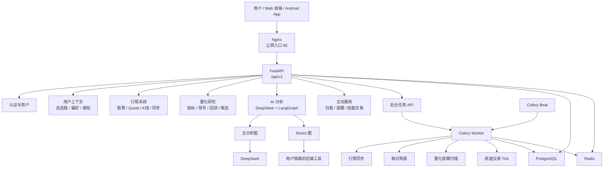
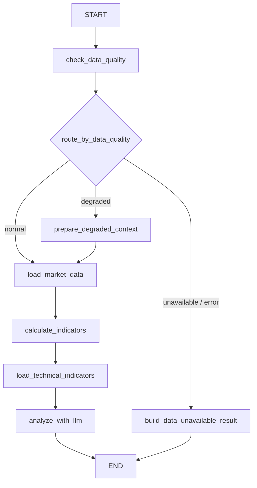
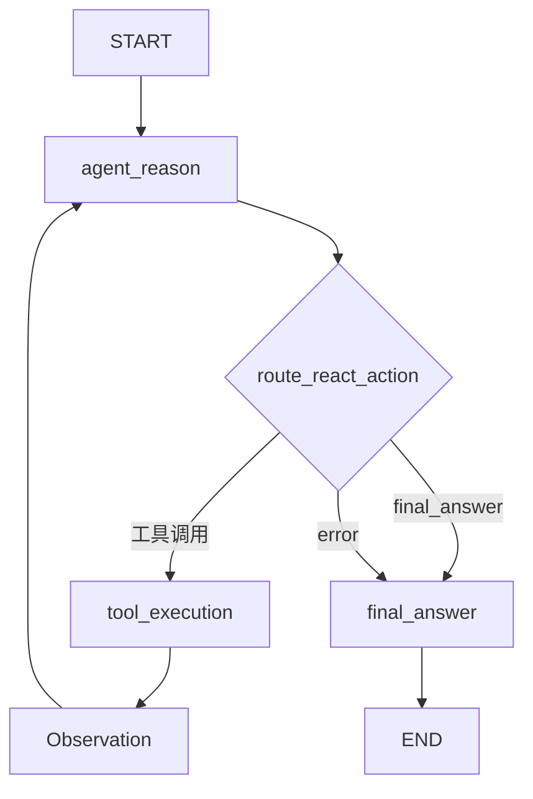

# LangGraph Commerce Stock Backend

一个基于 **FastAPI、PostgreSQL、Redis、Celery、DeepSeek 和 LangGraph** 的中文 AI 股票分析与量化研究后端系统。

本项目是一个 **商业兼顾学习** 的后端项目：学习为主，但整体结构、分层、测试、部署和验收都按接近商业后端项目的方式推进。项目当前重点在后端，适合用于学习完整后端链路、演示 AI 股票研究能力，以及作为后续 Web 前端或 Android App 的 API 服务基础。

> 重要声明：本系统仅用于学习、研究和辅助分析，不构成投资建议，不承诺未来收益，不连接券商，不进行真实下单。

## 当前状态

当前后端主线已经完成阶段性收官：

- 已完成用户、认证、自选股、偏好、通知等基础业务能力。
- 已完成真实行情同步、K 线落库、数据质量、技术指标、策略信号。
- 已完成 DeepSeek + LangGraph 个股 AI 分析。
- 已完成 ReAct 工具型追问和多轮会话持久化。
- 已完成单股回测、组合回测、候选股票评分、AI 候选解释。
- 已完成 AI 用量、额度和成本追踪。
- 已完成每日简报、量化提醒、纸面交易。
- 已完成 Celery 后台任务队列和定时任务基础能力。
- 已完成 pytest 通用测试体系和量化专项测试体系。
- 已完成腾讯云单机 Docker Compose 生产部署。
- 已完成最终验收、已知限制整理和交付评估。

当前生产形态适合：

```text
学习
演示
小范围试用
后续 Web 前端 / Android App 对接
```

当前还不适合：

```text
公开高并发访问
正式证券投顾服务
实盘交易
未加固的商业化生产使用
```

## 核心能力

| 模块 | 能力 |
| --- | --- |
| 认证与用户 | 注册、登录、刷新 Token、退出登录、当前用户信息 |
| 用户上下文 | 自选股、用户偏好、通知、设备 |
| 行情数据 | 股票搜索、Quote、K 线、行情同步、同步日志、同步状态 |
| 数据质量 | 空数据、数量不足、过旧、重复、非法 K 线检查 |
| 技术指标 | MA、EMA、RSI、MACD、波动率、动量、成交量因子 |
| 策略信号 | 确定性 `buy`、`sell`、`hold`、`observe`、`unavailable` 信号 |
| AI 主分析 | DeepSeek + LangGraph 个股分析 |
| 多轮追问 | 普通追问、ReAct 工具追问、会话消息落库 |
| ReAct 工具 | 分析记录、行情概览、技术指标、数据质量、用户偏好、自选股、回测、候选评分 |
| 单股回测 | 交易撮合、权益曲线、绩效指标、风控统计 |
| 组合回测 | 多资产权重、调仓、组合权益、组合绩效 |
| 候选评分 | 手动股票池或自选股股票池、评分、等级、排序、风险说明 |
| AI 候选解释 | 基于确定性候选评分结果进行 AI 中文解释 |
| AI 成本控制 | AI 用量日志、额度账户、Token 估算、成本估算 |
| 用户记忆 | 用户记忆、用户画像、向量检索 |
| 每日简报 | 确定性日报、AI 润色、通知 |
| 量化提醒 | 提醒规则、扫描、事件、通知 |
| 纸面交易 | 虚拟账户、配置、运行记录、虚拟订单、虚拟成交、模拟持仓、权益快照 |
| 后台任务 | Celery 任务提交、状态追踪、结果记录、失败处理 |
| 生产部署 | Docker Compose、Nginx、PostgreSQL、Redis、API、Worker、Beat |

## 技术栈

| 层级 | 技术 |
| --- | --- |
| Web 框架 | FastAPI |
| Schema 校验 | Pydantic |
| ORM | SQLAlchemy Async |
| 数据库迁移 | Alembic |
| 数据库 | PostgreSQL |
| 缓存 / 队列 | Redis |
| 后台任务 | Celery / Celery Beat |
| AI 编排 | LangGraph |
| LLM 客户端 | LangChain OpenAI-compatible client |
| LLM Provider | DeepSeek |
| 量化计算 | pandas、numpy |
| 包管理 | uv |
| 部署 | Docker Compose、Nginx |
| 测试 | pytest、pytest-asyncio |

## 系统架构



## 项目结构

```text
backend/
├── app/
│   ├── api/routers/       # HTTP API 路由
│   ├── core/              # 配置、数据库、Redis、安全、日志、异常、LLM
│   ├── graphs/            # LangGraph 状态、节点、路由、工具和图构建
│   ├── models/            # SQLAlchemy 数据模型
│   ├── repositories/      # 数据库访问层
│   ├── schemas/           # Pydantic 请求和响应结构
│   ├── services/          # 业务逻辑和流程编排
│   ├── tasks/             # Celery 后台任务
│   └── utils/             # 通用工具
├── alembic/               # 数据库迁移
├── nginx/                 # 生产 Nginx 配置
├── scripts/               # 测试回归脚本
├── tests/                 # pytest 测试
├── docker-compose.yml     # 本地 PostgreSQL / Redis
├── docker-compose.prod.yml
├── Dockerfile
├── pyproject.toml
└── README.md
```

## 代码分层原则

本项目采用清晰的后端分层：

| 层 | 目录 | 职责 |
| --- | --- | --- |
| API Router | `app/api/routers/` | HTTP 路径、鉴权、依赖注入、统一响应 |
| Schema | `app/schemas/` | 请求体、响应体、枚举、字段校验 |
| Service | `app/services/` | 业务规则、流程编排、调用 Graph 或 Repository |
| Repository | `app/repositories/` | 数据库读写、查询条件、用户隔离 |
| Model | `app/models/` | 表结构、字段、约束、索引、外键 |
| Graph | `app/graphs/` | LangGraph 状态流转、节点、工具调用 |
| Task | `app/tasks/` | Celery 后台任务和定时任务 |
| Core | `app/core/` | 配置、数据库、Redis、JWT、安全、日志、异常、LLM |

原则：

```text
Router 不写复杂业务逻辑；
Service 负责业务编排；
Repository 负责数据访问；
Graph 负责 AI 状态流；
Model 只描述数据库结构。
```

## API 模块

所有业务 API 默认挂载在 `/api/v1` 下。

| 模块 | 路由前缀 |
| --- | --- |
| 系统健康 | `/system` |
| 认证 | `/auth` |
| 用户 | `/users` |
| 自选股 | `/watchlist` |
| 用户偏好 | `/preferences` |
| 通知 | `/notifications` |
| 设备 | `/devices` |
| 分析记录 | `/analysis-records` |
| 个股 AI 分析 | `/analysis` |
| 分析会话 | `/analysis-conversations` |
| 行情查询 | `/market` |
| 行情同步 | `/market-sync` |
| 数据质量 | `/market-data-quality` |
| 技术指标 | `/technical-indicators` |
| 策略信号 | `/strategy-signals` |
| 单股回测 | `/backtests` |
| 组合回测 | `/portfolio-backtests` |
| 候选股票评分 | `/stock-candidates` |
| 候选 AI 解释 | `/stock-candidate-ai-explanations` |
| AI 用量和额度 | `/ai-usage` |
| 后台任务 | `/background-tasks` |
| 用户记忆 | `/user-memories` |
| 用户记忆检索 | `/user-memory-retrieval` |
| 每日简报 | `/daily-reports` |
| 量化提醒 | `/quant-alerts` |
| 纸面交易 | `/paper-trading` |

常用运行入口：

```text
GET /api/v1/system/health
GET /openapi.json
GET /docs
```

几个容易写错的路径：

```text
GET  /api/v1/market-data-quality/stocks/{symbol}/report
POST /api/v1/stock-candidates
```

## 两个 LangGraph 工作流

### 主分析图

文件：

```text
app/graphs/stock_analysis_graph.py
```



说明：

- 先判断行情和 K 线数据质量。
- 数据可用时进入 normal 路线，加载行情、指标、策略信号后调用 DeepSeek。
- 数据不足时进入 degraded 或 unavailable 路线。
- 系统不会在缺少数据时强行让 AI 编造分析。

### ReAct 追问图

文件：

```text
app/graphs/stock_analysis_react_graph.py
```



说明：

- 用户只调用 ReAct 追问 API。
- ReAct 工具不是公网 API。
- Graph 根据 LLM 推理结果决定是否调用工具。
- 工具调用结果会形成 Observation，再回到推理节点。
- 工具调用、Observation 和最终回答会保存 Trace，便于审计。

## ReAct 工具

| 工具 | 作用 |
| --- | --- |
| `get_analysis_record` | 读取当前用户的分析记录 |
| `get_market_overview` | 读取行情、K 线、数据质量、指标、策略信号 |
| `get_technical_indicators` | 读取技术指标摘要 |
| `get_data_quality` | 读取数据质量报告 |
| `get_user_preference` | 读取当前用户偏好 |
| `get_watchlist` | 读取当前用户自选股 |
| `get_backtest_result` | 执行或总结单股回测 |
| `get_stock_candidates` | 执行候选股票评分 |

工具边界：

```text
工具由后端函数调用执行；
工具受当前登录用户限制；
工具调用结果会进入 Trace；
工具不能越权读取其他用户数据。
```

## 本地开发

### 环境要求

- Python 3.11+
- uv
- Docker
- Docker Compose

### 安装依赖

```powershell
cd backend
uv sync
```

### 启动本地基础设施

```powershell
docker compose up -d
```

本地 `docker-compose.yml` 默认只启动 PostgreSQL 和 Redis。

### 配置本地环境变量

```powershell
Copy-Item .env.example .env
```

根据本机情况修改：

```text
DATABASE_URL
DATABASE_ASYNC_URL
REDIS_URL
JWT_SECRET_KEY
DEEPSEEK_API_KEY
MARKET_DATA_PRIMARY_PROVIDER
TUSHARE_TOKEN
```

### 执行数据库迁移

```powershell
uv run alembic upgrade head
uv run alembic current
```

### 启动 API

```powershell
uv run uvicorn app.main:app --reload
```

默认访问：

```text
http://127.0.0.1:8000
```

## 测试环境

项目支持通过 `.env.test` 隔离测试数据库和测试 Redis。

创建测试环境文件：

```powershell
Copy-Item .env.test.example .env.test
```

设置当前终端使用测试环境：

```powershell
$env:APP_ENV_FILE = ".env.test"
```

对测试库执行迁移：

```powershell
uv run alembic upgrade head
```

运行全部测试：

```powershell
uv run pytest
```

运行阶段九通用回归：

```powershell
.\scripts\run_stage9_tests.ps1 -Target all
```

运行阶段九-A量化专项回归：

```powershell
.\scripts\run_stage9a_quant_tests.ps1 -Target all
```

测试覆盖：

```text
认证
用户上下文
行情 API
Mock LLM
ReAct
回测
候选评分
后台任务
主动服务
用户隔离
技术指标
策略信号
组合回测
纸面交易一致性
```

## 生产部署

当前生产部署采用单机 Docker Compose：

| 服务 | 说明 |
| --- | --- |
| `nginx` | 公网 HTTP 入口，开放 80 |
| `api` | FastAPI 应用，只在 Docker 内网暴露 8000 |
| `worker` | Celery Worker |
| `beat` | Celery Beat |
| `postgres` | PostgreSQL，不暴露公网 |
| `redis` | Redis，不暴露公网 |

### 准备生产环境变量

```bash
cp .env.production.example .env.production
nano .env.production
```

必须替换：

```text
POSTGRES_PASSWORD
DATABASE_URL
DATABASE_ASYNC_URL
JWT_SECRET_KEY
DEEPSEEK_API_KEY
TUSHARE_TOKEN
```

注意：

```text
.env.production 不能提交 Git。
```

### 构建镜像

```bash
docker compose --env-file .env.production -f docker-compose.prod.yml build
```

### 启动 PostgreSQL 和 Redis

```bash
docker compose --env-file .env.production -f docker-compose.prod.yml up -d postgres redis
```

### 执行迁移

```bash
docker compose --env-file .env.production -f docker-compose.prod.yml run --rm api uv run alembic upgrade head
```

### 启动完整服务

```bash
docker compose --env-file .env.production -f docker-compose.prod.yml up -d
```

### 查看状态

```bash
docker compose --env-file .env.production -f docker-compose.prod.yml ps
```

### 健康检查

```bash
curl http://YOUR_SERVER_IP/api/v1/system/health
```

## 生产端口边界

生产 Compose 只把 Nginx 暴露到公网。

| 服务 | 公网暴露 |
| --- | --- |
| Nginx | 80 |
| FastAPI | 不暴露公网，仅 Docker 内网 |
| PostgreSQL | 不暴露公网，仅 Docker 内网 |
| Redis | 不暴露公网，仅 Docker 内网 |

## 行情 Provider 说明

当前同步服务中实际支持的 Provider 分支：

```text
mock
baostock
tushare
```

如果生产环境配置了当前代码不支持的 Provider，接口会返回不支持该 Provider。

当前已知限制：

```text
MARKET_DATA_FALLBACK_PROVIDERS 尚未形成完整自动降级链路；
.env.production.example 中如出现 akshare 示例，需要在生产使用前修正为当前代码实际支持的 Provider。
```

## 纸面交易边界

纸面交易是虚拟模拟盘：

```text
虚拟账户
虚拟订单
虚拟成交
模拟持仓
权益快照
运行记录
```

它不会：

```text
连接券商
真实下单
真实成交
代表真实资金账户
承诺未来收益
```

## 安全与合规边界

当前系统已经具备的边界：

- 用户资源按 `user_id` 隔离。
- PostgreSQL 不直接暴露公网。
- Redis 不直接暴露公网。
- FastAPI 8000 不直接暴露公网。
- 真实密钥不应提交 Git。
- AI 输出有免责声明和安全边界。
- 回测、候选评分、纸面交易都只用于研究辅助。

正式公开使用前仍建议补充：

- HTTPS
- 域名和备案
- SSH Key 登录并禁用密码登录
- 自动数据库备份
- 监控和告警
- API 限流
- CI/CD
- 股票相关服务合规审查

## 已知限制

- 当前生产部署暂未配置 HTTPS。
- 当前生产部署暂未配置域名和备案。
- 当前暂未接入自动备份任务。
- 当前暂未接入集中监控和告警。
- 当前暂未配置 CI/CD。
- 当前是单机部署，不具备高可用。
- 当前不适合公开高并发访问。
- 行情 Provider 依赖外部服务，可能失败、超时或返回缺失数据。
- Provider fallback 配置尚未形成完整自动降级链路。
- AI 调用可能失败、超时或触发额度限制。
- AI 输出只作为辅助解释，不应作为事实来源。
- 回测和纸面交易结果不代表未来收益。
- 本系统不构成投资建议，不接券商，不真实下单。

## 后续路线

| 优先级 | 方向 | 说明 |
| --- | --- | --- |
| P0 | 修正生产 Provider 示例 | 避免模板与代码支持范围不一致 |
| P0 | HTTPS | 登录和 Token 传输需要加密 |
| P0 | 自动备份 | 保护用户和业务数据 |
| P1 | SSH 加固 | 使用密钥登录，限制来源 IP |
| P1 | 监控告警 | 监控 500、502、容器重启、磁盘空间 |
| P1 | API 限流 | 保护 AI、回测、候选、日报等重接口 |
| P1 | Web 前端 | 基于 OpenAPI 开发浏览器端 |
| P1 | Android App | 基于公网 API 开发移动端 |
| P2 | CI/CD | 降低手动部署错误 |
| P2 | RDS / 云 Redis | 提升可靠性 |
| P2 | Provider fallback manager | 主行情源失败后自动切换 |
| P3 | 商业合规审查 | 正式公开股票相关服务前必须补齐 |

## 开发约定

- 优先保持现有分层。
- 不把复杂业务逻辑写进 Router。
- Service 负责业务流程。
- Repository 负责数据读写。
- Model 只定义表结构。
- Schema 负责请求和响应校验。
- Graph 负责 LangGraph 状态流和工具调用。
- 涉及用户数据时必须做用户隔离。
- AI、策略、回测、纸面交易必须保留免责声明和风险边界。

## 许可证

当前尚未选择开源许可证。

如果后续公开复用或商业分发，请先补充合适的 License，并确认第三方依赖、行情数据源和股票相关服务的合规要求。
