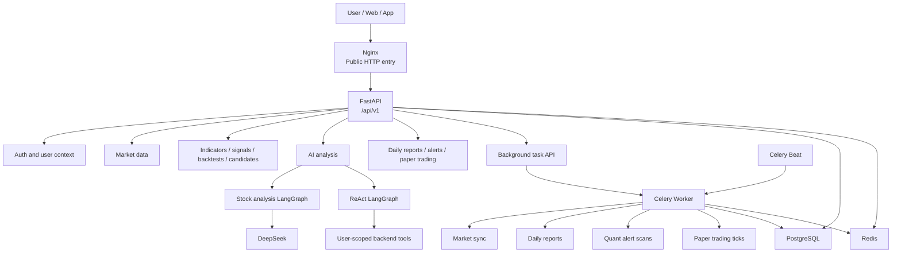
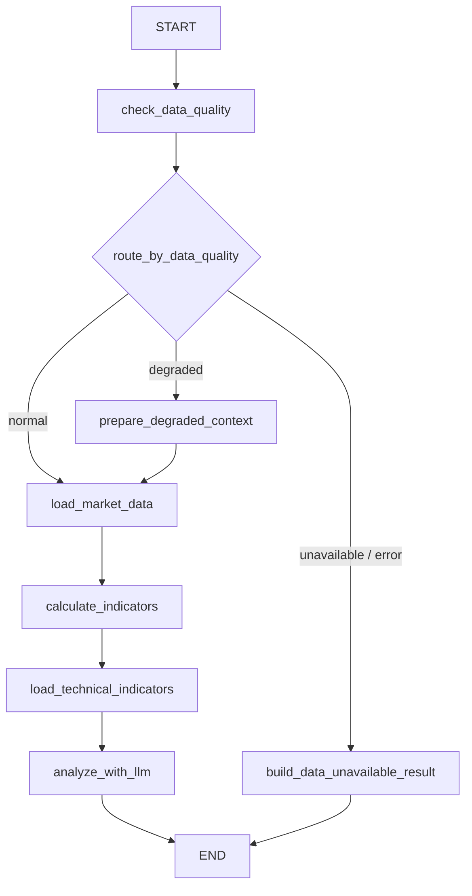
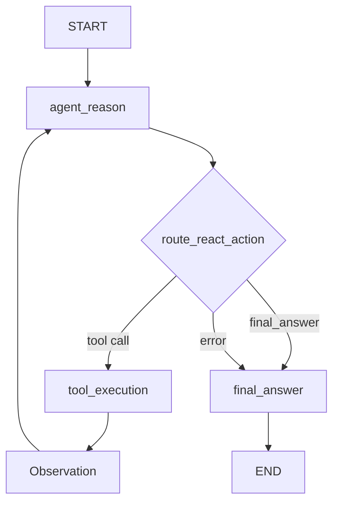

# LangGraph Commerce Stock Backend

An AI-powered stock research backend built with FastAPI, PostgreSQL, Redis, Celery, DeepSeek, and LangGraph.

This project is a learning-first but business-style backend system. It provides user accounts, watchlists, market data synchronization, technical indicators, strategy signals, AI stock analysis, ReAct follow-up conversations, backtesting, stock candidate scoring, daily reports, quantitative alerts, paper trading, background tasks, test suites, and a Docker Compose production deployment.

> This system is for research and learning only. It does not provide investment advice, does not guarantee returns, does not connect to brokers, and does not place real orders.

## Project Status

The backend has completed its current main development track:

- Core backend services are implemented.
- Main APIs have been verified in production.
- Two LangGraph workflows are implemented and validated.
- General pytest coverage and quantitative-specialized tests are available.
- A single-server Docker Compose production deployment has been completed.
- Known limits and production hardening items are documented.

The current production shape is suitable for learning, demonstration, and small-scope trials. It is not yet hardened for public high-concurrency commercial use.

## Core Capabilities

| Area | Capabilities |
| --- | --- |
| Authentication | Register, login, refresh token, logout, current user |
| User context | Watchlist, preferences, notifications, devices |
| Market data | Symbol search, quotes, candles, sync logs, sync status |
| Data quality | Empty, insufficient, stale, duplicated, and invalid candle detection |
| Technical indicators | MA, EMA, RSI, MACD, volatility, momentum, volume factors |
| Strategy signals | Deterministic `buy`, `sell`, `hold`, `observe`, and `unavailable` signals |
| AI analysis | DeepSeek-powered stock analysis through LangGraph |
| Conversations | Normal follow-up and ReAct tool-based follow-up |
| ReAct tools | Analysis record, overview, indicators, data quality, preference, watchlist, backtest, candidates |
| Backtesting | Single-stock backtest, equity curve, trades, performance metrics |
| Portfolio backtesting | Multi-asset weights, rebalancing, portfolio equity, portfolio metrics |
| Candidate scoring | Manual or watchlist universe, score, grade, rank, risk notes |
| AI candidate explanation | AI explanation over deterministic scoring results |
| AI usage control | Quota account, usage logs, token estimates, cost estimates |
| User memory | Memories, profiles, embeddings, retrieval |
| Daily reports | Deterministic report, optional AI polishing, notification support |
| Quant alerts | Rules, scans, events, notifications |
| Paper trading | Virtual accounts, config, runs, orders, trades, positions, equity snapshots |
| Background tasks | Celery task submission, status tracking, result recording, failure handling |
| Production deployment | Docker Compose, Nginx, PostgreSQL, Redis, API, worker, beat |

## Architecture



## LangGraph Workflows

### Stock Analysis Graph

File: `app/graphs/stock_analysis_graph.py`



The graph first checks market data quality, then chooses a normal, degraded, unavailable, or error path. The LLM is called only when enough context exists. If data is unavailable, the system returns a safe response instead of fabricating analysis.

### ReAct Follow-up Graph

File: `app/graphs/stock_analysis_react_graph.py`



ReAct tools are not public API endpoints. Users call the ReAct follow-up API, and the graph decides whether to invoke a backend tool. Tool calls are scoped to the authenticated user and recorded through trace data.

## ReAct Tools

| Tool | Purpose |
| --- | --- |
| `get_analysis_record` | Load the current user's stock analysis record |
| `get_market_overview` | Load quote, candle, data quality, indicator, and signal context |
| `get_technical_indicators` | Load technical indicator summaries |
| `get_data_quality` | Load market data quality reports |
| `get_user_preference` | Load the current user's preferences |
| `get_watchlist` | Load the current user's watchlist |
| `get_backtest_result` | Run or summarize a stock backtest |
| `get_stock_candidates` | Score and rank stock candidates |

## Tech Stack

| Layer | Technology |
| --- | --- |
| API | FastAPI |
| Schema validation | Pydantic |
| Database ORM | SQLAlchemy async |
| Migrations | Alembic |
| Database | PostgreSQL |
| Cache / queue | Redis |
| Background jobs | Celery / Celery Beat |
| AI graph orchestration | LangGraph |
| LLM client | LangChain OpenAI-compatible client |
| LLM provider | DeepSeek |
| Quant computation | pandas, numpy |
| Package manager | uv |
| Deployment | Docker Compose, Nginx |
| Testing | pytest, pytest-asyncio |

## Repository Layout

```text
backend/
├── app/
│   ├── api/routers/       # HTTP API routers
│   ├── core/              # config, database, Redis, logging, security, exceptions, LLM
│   ├── graphs/            # LangGraph states, nodes, routers, tools, graph builders
│   ├── models/            # SQLAlchemy models
│   ├── repositories/      # database access layer
│   ├── schemas/           # Pydantic request and response models
│   ├── services/          # business orchestration and domain logic
│   ├── tasks/             # Celery tasks
│   └── utils/             # shared utilities
├── alembic/               # database migrations
├── nginx/                 # production Nginx config
├── scripts/               # regression test scripts
├── tests/                 # pytest suites
├── docker-compose.yml     # local PostgreSQL and Redis
├── docker-compose.prod.yml
├── Dockerfile
├── pyproject.toml
└── README.md
```

## API Modules

All application APIs are mounted under `/api/v1`.

| Module | Router |
| --- | --- |
| System health | `/system` |
| Authentication | `/auth` |
| Users | `/users` |
| Watchlist | `/watchlist` |
| Preferences | `/preferences` |
| Notifications | `/notifications` |
| Devices | `/devices` |
| Analysis records | `/analysis-records` |
| Stock analysis | `/analysis` |
| Conversations | `/analysis-conversations` |
| Market query | `/market` |
| Market sync | `/market-sync` |
| Market data quality | `/market-data-quality` |
| Technical indicators | `/technical-indicators` |
| Strategy signals | `/strategy-signals` |
| Single-stock backtests | `/backtests` |
| Portfolio backtests | `/portfolio-backtests` |
| Stock candidates | `/stock-candidates` |
| Candidate AI explanations | `/stock-candidate-ai-explanations` |
| AI usage and quota | `/ai-usage` |
| Background tasks | `/background-tasks` |
| User memories | `/user-memories` |
| User memory retrieval | `/user-memory-retrieval` |
| Daily reports | `/daily-reports` |
| Quant alerts | `/quant-alerts` |
| Paper trading | `/paper-trading` |

Useful runtime endpoints:

- Health check: `GET /api/v1/system/health`
- OpenAPI schema: `GET /openapi.json`
- Swagger UI: `GET /docs`

## Local Development

### Requirements

- Python 3.11+
- uv
- Docker and Docker Compose
- PostgreSQL and Redis through Docker Compose

### Install dependencies

```powershell
cd backend
uv sync
```

### Start local infrastructure

```powershell
docker compose up -d
```

The local compose file starts PostgreSQL and Redis for development.

### Configure environment

```powershell
Copy-Item .env.example .env
```

Then edit `.env` as needed:

- `DATABASE_URL`
- `DATABASE_ASYNC_URL`
- `REDIS_URL`
- `JWT_SECRET_KEY`
- `DEEPSEEK_API_KEY`
- market data provider settings

### Run migrations

```powershell
uv run alembic upgrade head
uv run alembic current
```

### Start the API

```powershell
uv run uvicorn app.main:app --reload
```

The API will be available at:

```text
http://127.0.0.1:8000
```

## Test Environment

The project supports an isolated test environment through `.env.test`.

Create a local test env:

```powershell
Copy-Item .env.test.example .env.test
```

Set the test env file:

```powershell
$env:APP_ENV_FILE = ".env.test"
```

Run migrations against the test database:

```powershell
uv run alembic upgrade head
```

Run all tests:

```powershell
uv run pytest
```

Run staged regression scripts:

```powershell
.\scripts\run_stage9_tests.ps1 -Target all
.\scripts\run_stage9a_quant_tests.ps1 -Target all
```

The test suites cover authentication, user context, market APIs, AI mock flows, ReAct flows, research APIs, background tasks, active services, user isolation, quantitative indicators, backtests, risk controls, portfolio logic, candidate scoring, and paper trading consistency.

## Production Deployment

The current production deployment uses one server with Docker Compose.

Services:

- `nginx`: public HTTP entry on port 80
- `api`: FastAPI application, exposed only inside the Docker network
- `worker`: Celery worker
- `beat`: Celery beat
- `postgres`: PostgreSQL, not exposed publicly
- `redis`: Redis, not exposed publicly

Prepare production env:

```bash
cp .env.production.example .env.production
nano .env.production
```

Fill strong production values:

- `POSTGRES_PASSWORD`
- `DATABASE_URL`
- `DATABASE_ASYNC_URL`
- `JWT_SECRET_KEY`
- `DEEPSEEK_API_KEY`
- market data provider settings

Build:

```bash
docker compose --env-file .env.production -f docker-compose.prod.yml build
```

Start database and Redis:

```bash
docker compose --env-file .env.production -f docker-compose.prod.yml up -d postgres redis
```

Run migrations:

```bash
docker compose --env-file .env.production -f docker-compose.prod.yml run --rm api uv run alembic upgrade head
```

Start all services:

```bash
docker compose --env-file .env.production -f docker-compose.prod.yml up -d
```

Check service status:

```bash
docker compose --env-file .env.production -f docker-compose.prod.yml ps
```

Check health:

```bash
curl http://YOUR_SERVER_IP/api/v1/system/health
```

## Security and Production Boundaries

The production compose file intentionally exposes only Nginx to the public network.

| Service | Public exposure |
| --- | --- |
| Nginx | port 80 |
| FastAPI | not public, Docker internal network |
| PostgreSQL | not public, Docker internal network |
| Redis | not public, Docker internal network |

Secrets must be stored in `.env`, `.env.test`, or `.env.production`. Real secret files must not be committed.

Before public commercial use, the following items should be added:

- HTTPS
- domain name and ICP filing if serving mainland China users through a domain
- SSH key-only login and source IP restrictions
- automatic PostgreSQL backups
- monitoring and alerting
- API rate limiting
- CI/CD
- legal and compliance review for stock-related services

## Market Data Notes

The current code builds market data providers from the primary provider setting. Supported provider branches in the synchronization service are:

- `mock`
- `baostock`
- `tushare`

The configuration template may contain provider placeholders that should be reviewed before production use. If a provider is not supported by the current service implementation, the API will reject it.

## Paper Trading Boundaries

Paper trading is a virtual simulation feature:

- virtual account
- virtual orders
- virtual trades
- virtual positions
- virtual equity snapshots
- run records

It does not connect to any broker, does not place real orders, and does not represent a real brokerage account.

## Known Limitations

- No HTTPS in the first production deployment.
- No domain name or ICP filing yet.
- No automatic backup job yet.
- No centralized monitoring or alerting yet.
- No CI/CD deployment pipeline yet.
- Single-server deployment; no high availability.
- No complete provider fallback manager yet.
- AI outputs can fail, time out, or require fallback.
- Backtests and paper trading results do not predict future returns.
- The current server shape is suitable for learning, demos, and small-scope trials, not public high-concurrency use.

## Development Principles

The codebase follows a layered backend structure:

- Router handles HTTP concerns.
- Schema handles request and response validation.
- Service handles business logic and workflow orchestration.
- Repository handles database reads and writes.
- Model defines table structure, constraints, indexes, and relationships.
- Graph handles LangGraph state transitions, nodes, and tool execution.
- Task handles Celery background execution.

Complex business logic should not be placed directly in routers.

## License

No license has been selected yet. Add a license before public reuse or commercial distribution.
