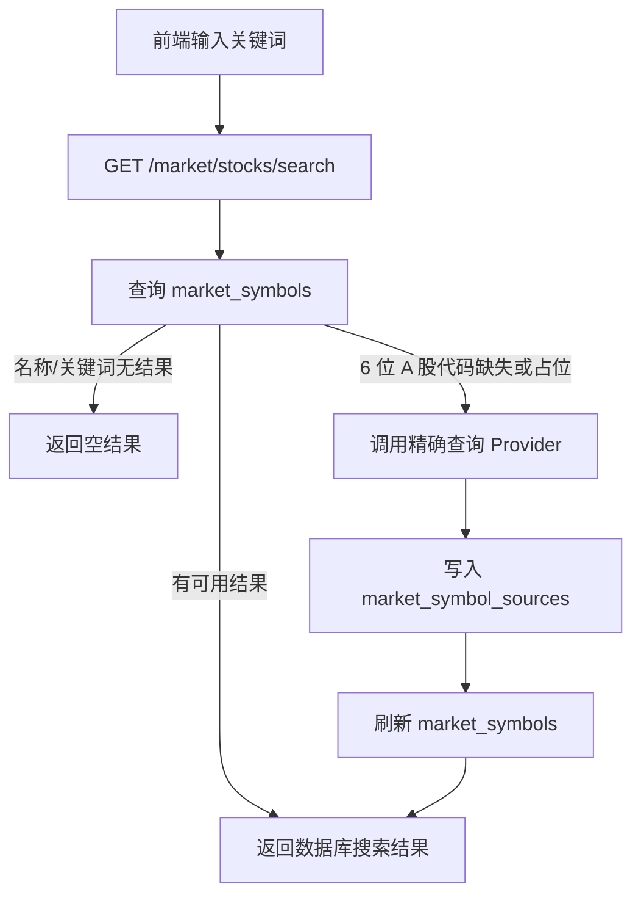

# API 全面介绍

本文按当前 `backend/app/api/routers/` 和 `backend/app/schemas/` 整理后端 API，面向 Android / Web 前端对接。

统一前缀：

```text
/api/v1
```

除 `GET /system/health`、`POST /auth/register`、`POST /auth/login`、`POST /auth/refresh` 外，业务接口默认需要登录并携带：

```http
Authorization: Bearer <access_token>
```

## 一、接口总览

| 模块 | Method | Path | 登录 | 用途 |
| ---- | ------ | ---- | ---- | ---- |
| system | GET | `/system/health` | 否 | 健康检查 |
| system | GET | `/system/error-demo` | 否 | 异常处理演示，不建议前端使用 |
| auth | POST | `/auth/register` | 否 | 注册用户 |
| auth | POST | `/auth/login` | 否 | 登录并获取 token |
| auth | POST | `/auth/refresh` | 否 | 刷新 token |
| auth | POST | `/auth/logout` | 是 | 退出登录并注销 token |
| users | GET | `/users/me` | 是 | 当前用户资料 |
| users | PATCH | `/users/me` | 是 | 更新当前用户资料 |
| preferences | GET | `/preferences/me` | 是 | 当前用户偏好 |
| preferences | PATCH | `/preferences/me` | 是 | 更新当前用户偏好 |
| watchlist | POST | `/watchlist` | 是 | 新增自选股 |
| watchlist | GET | `/watchlist` | 是 | 当前用户自选股列表 |
| watchlist | GET | `/watchlist/{item_id}` | 是 | 自选股详情 |
| watchlist | PATCH | `/watchlist/{item_id}` | 是 | 更新自选股 |
| watchlist | DELETE | `/watchlist/{item_id}` | 是 | 删除自选股 |
| devices | POST | `/devices` | 是 | 注册或更新设备 |
| devices | GET | `/devices` | 是 | 当前用户设备列表 |
| devices | PATCH | `/devices/{device_id}/deactivate` | 是 | 停用设备 |
| notifications | GET | `/notifications` | 是 | 通知列表 |
| notifications | GET | `/notifications/{notification_id}` | 是 | 通知详情 |
| notifications | PATCH | `/notifications/{notification_id}/read` | 是 | 标记单条通知已读 |
| notifications | PATCH | `/notifications/read-all` | 是 | 标记全部通知已读 |
| notifications | DELETE | `/notifications/{notification_id}` | 是 | 删除当前用户通知，保留关联业务记录 |
| market | GET | `/market/stocks/search` | 是 | 搜索股票 |
| market | GET | `/market/stocks/{symbol}/quote` | 是 | 获取报价 |
| market | GET | `/market/stocks/{symbol}/candles` | 是 | 获取 K 线 |
| market | GET | `/market/stocks/{symbol}/indicators` | 是 | 获取基础指标 |
| market | GET | `/market/stocks/{symbol}/overview` | 是 | 获取行情聚合概览 |
| market-sync | POST | `/market-sync/symbol-pool` | 是 | 同步股票基础信息池 |
| market-sync | POST | `/market-sync/symbols/{symbol}` | 是 | 同步股票基础信息 |
| market-sync | POST | `/market-sync/stocks/{symbol}/candles` | 是 | 同步 K 线 |
| market-data-quality | GET | `/market-data-quality/stocks/{symbol}/report` | 是 | 数据质量报告 |
| market-data-quality | GET | `/market-data-quality/sync-statuses` | 是 | 同步状态列表 |
| market-data-quality | GET | `/market-data-quality/sync-logs` | 是 | 同步日志列表 |
| technical-indicators | GET | `/technical-indicators/stocks/{symbol}/summary` | 是 | 技术指标汇总 |
| technical-indicators | GET | `/technical-indicators/stocks/{symbol}/ma` | 是 | 均线指标 |
| technical-indicators | GET | `/technical-indicators/stocks/{symbol}/rsi` | 是 | RSI |
| technical-indicators | GET | `/technical-indicators/stocks/{symbol}/macd` | 是 | MACD |
| technical-indicators | GET | `/technical-indicators/stocks/{symbol}/volatility` | 是 | 波动率 |
| technical-indicators | GET | `/technical-indicators/stocks/{symbol}/momentum` | 是 | 动量 |
| technical-indicators | GET | `/technical-indicators/stocks/{symbol}/volume` | 是 | 成交量因子 |
| strategy-signals | GET | `/strategy-signals/stocks/{symbol}` | 是 | 策略信号 |
| analysis | POST | `/analysis/stock` | 是 | 个股 AI 主分析 |
| analysis | POST | `/analysis/stock/follow-up` | 是 | 普通追问 |
| analysis | POST | `/analysis/stock/react-follow-up` | 是 | ReAct 工具增强追问 |
| analysis-records | GET | `/analysis-records` | 是 | 分析记录列表 |
| analysis-records | GET | `/analysis-records/{record_id}` | 是 | 分析记录详情 |
| analysis-conversations | GET | `/analysis-conversations/{analysis_thread_id}/messages` | 是 | 分析线程消息 |
| analysis-conversations | GET | `/analysis-conversations/{analysis_thread_id}/traces` | 是 | ReAct trace |
| analysis-conversations | GET | `/analysis-conversations/{analysis_thread_id}/context` | 是 | 最近会话上下文 |
| backtests | POST | `/backtests` | 是 | 单股回测 |
| portfolio-backtests | POST | `/portfolio-backtests` | 是 | 组合回测 |
| stock-candidates | POST | `/stock-candidates` | 是 | 候选股票评分 |
| stock-candidate-ai-explanations | POST | `/stock-candidate-ai-explanations` | 是 | AI 候选解释 |
| ai-usage | GET | `/ai-usage/quota` | 是 | AI 额度摘要 |
| ai-usage | GET | `/ai-usage/logs` | 是 | AI 使用日志 |
| ai-usage | POST | `/ai-usage/quota/check` | 是 | 检查 AI 额度 |
| background-tasks | POST | `/background-tasks` | 是 | 提交后台任务 |
| background-tasks | GET | `/background-tasks` | 是 | 后台任务列表 |
| background-tasks | GET | `/background-tasks/{task_id}` | 是 | 后台任务详情 |
| background-tasks | POST | `/background-tasks/{task_id}/cancel` | 是 | 取消后台任务 |
| user-memories | GET | `/user-memories` | 是 | 用户记忆列表 |
| user-memories | GET | `/user-memories/profile` | 是 | 用户画像 |
| user-memories | POST | `/user-memories/profile/refresh` | 是 | 刷新用户画像 |
| user-memories | GET | `/user-memories/{memory_id}` | 是 | 用户记忆详情 |
| user-memories | PATCH | `/user-memories/{memory_id}` | 是 | 更新用户记忆 |
| user-memories | POST | `/user-memories/{memory_id}/deactivate` | 是 | 停用用户记忆 |
| user-memory-retrieval | POST | `/user-memory-retrieval/search` | 是 | 相似记忆检索 |
| daily-reports | POST | `/daily-reports/generate` | 是 | 生成日报 |
| daily-reports | GET | `/daily-reports/mode` | 是 | 查询当前用户日报模式 |
| daily-reports | PATCH | `/daily-reports/mode` | 是 | 开启或关闭当前用户日报模式 |
| daily-reports | GET | `/daily-reports` | 是 | 日报列表 |
| daily-reports | GET | `/daily-reports/today` | 是 | 今日日报 |
| daily-reports | GET | `/daily-reports/{report_id}` | 是 | 日报详情 |
| quant-alerts | POST | `/quant-alerts/rules` | 是 | 创建提醒规则 |
| quant-alerts | GET | `/quant-alerts/rules` | 是 | 提醒规则列表 |
| quant-alerts | GET | `/quant-alerts/rules/{rule_id}` | 是 | 提醒规则详情 |
| quant-alerts | PATCH | `/quant-alerts/rules/{rule_id}` | 是 | 更新提醒规则 |
| quant-alerts | POST | `/quant-alerts/rules/{rule_id}/deactivate` | 是 | 停用提醒规则 |
| quant-alerts | GET | `/quant-alerts/events` | 是 | 提醒事件列表 |
| quant-alerts | GET | `/quant-alerts/events/{event_id}` | 是 | 提醒事件详情 |
| quant-alerts | PATCH | `/quant-alerts/events/{event_id}` | 是 | 更新提醒事件 |
| quant-alerts | POST | `/quant-alerts/scan` | 是 | 手动扫描提醒 |
| paper-trading | POST | `/paper-trading/accounts` | 是 | 创建纸面交易账户 |
| paper-trading | GET | `/paper-trading/accounts` | 是 | 纸面交易账户列表 |
| paper-trading | GET | `/paper-trading/accounts/{account_id}` | 是 | 账户详情聚合 |
| paper-trading | PATCH | `/paper-trading/accounts/{account_id}` | 是 | 更新账户 |
| paper-trading | DELETE | `/paper-trading/accounts/{account_id}` | 是 | 删除虚拟账户及其模拟子数据 |
| paper-trading | GET | `/paper-trading/accounts/{account_id}/config` | 是 | 获取账户配置 |
| paper-trading | PATCH | `/paper-trading/accounts/{account_id}/config` | 是 | 更新账户配置 |
| paper-trading | GET | `/paper-trading/accounts/{account_id}/positions` | 是 | 模拟持仓 |
| paper-trading | GET | `/paper-trading/accounts/{account_id}/orders` | 是 | 虚拟订单 |
| paper-trading | GET | `/paper-trading/accounts/{account_id}/trades` | 是 | 虚拟成交 |
| paper-trading | GET | `/paper-trading/accounts/{account_id}/equity` | 是 | 权益快照 |
| paper-trading | POST | `/paper-trading/accounts/{account_id}/tick` | 是 | 推进一次模拟 tick |
| paper-trading | GET | `/paper-trading/accounts/{account_id}/runs` | 是 | tick 运行记录 |
| paper-trading | GET | `/paper-trading/accounts/{account_id}/runs/{run_id}` | 是 | 运行记录详情 |

## 二、认证与用户

### `POST /auth/register`

请求体：

| 字段 | 类型 | 说明 |
| ---- | ---- | ---- |
| `email` | Email | 注册邮箱 |
| `username` | string | 3 到 50 个字符 |
| `password` | string | 3 到 128 个字符 |

响应：`UserResponse`，包含用户 ID、邮箱、用户名、状态等，不包含密码。

### `POST /auth/login`

请求体：

| 字段 | 类型 | 必填 | 说明 |
| ---- | ---- | ---- | ---- |
| `email` | Email | 是 | 登录邮箱 |
| `password` | string | 是 | 8 到 128 个字符 |
| `platform` | string | 否 | 设备平台：`android`、`ios`、`web`、`unknown`，Android App 建议固定传 `android` |
| `device_fingerprint` | string | 否 | 前端生成并持久保存的设备指纹，后端只保存 hash，不保存原文 |
| `device_name` | string | 否 | 设备名称，例如手机型号或浏览器名称 |
| `push_token` | string | 否 | 推送 token；有值时后端会登记或更新设备信息 |
| `app_version` | string | 否 | App 版本号，便于排查兼容问题 |

响应：

| 字段 | 说明 |
| ---- | ---- |
| `access_token` | 短期访问 token，payload 中绑定本次 `session_id` |
| `refresh_token` | 刷新 token，服务端只保存 hash |
| `token_type` | 固定为 `bearer` |
| `session_id` | 服务端登录会话 ID |
| `device_category` | 设备类别：`mobile`、`web`、`unknown` |
| `replaced_sessions_count` | 本次登录替换的旧同类设备会话数量 |

登录会话规则：

```text
android / ios 归类为 mobile；
web 归类为 web；
同一账号在同一 device_category 下只保留一个有效 session；
新同类设备登录后，旧同类 session 会被撤销，旧 access token 即使未自然过期也会失效；
mobile 与 web 不互踢，可以同时保持登录。
```

旧设备继续请求受保护接口时，后端会返回 401，错误信息中可能包含 `replaced_by_same_category_login`，前端应提示“账号已在另一台同类设备登录”，然后清空本地 token 并跳转登录页。
### `POST /auth/refresh`

请求体：`refresh_token`。

响应：新的 `access_token` 和 `refresh_token`。

### `POST /auth/logout`

请求体：`refresh_token`。需要同时携带当前 access token。

响应：`{"message": "logout success"}`。

### `GET /users/me` / `PATCH /users/me`

获取或更新当前用户资料。前端“我的页面”使用。

## 三、偏好、自选股、通知与设备

### 偏好

| 接口 | 请求 | 响应 | 说明 |
| ---- | ---- | ---- | ---- |
| `GET /preferences/me` | 无 | `UserPreferenceResponse` | 获取风险偏好、通知偏好等 |
| `PATCH /preferences/me` | 偏好字段 | `UserPreferenceResponse` | 更新当前用户偏好 |

### 自选股

| 接口 | 关键参数 | 响应 | 说明 |
| ---- | -------- | ---- | ---- |
| `POST /watchlist` | `symbol`、`market`、备注/提醒配置 | `WatchlistResponse` | 添加自选股 |
| `GET /watchlist` | 无 | `list[WatchlistResponse]` | 当前用户自选股 |
| `GET /watchlist/{item_id}` | `item_id` | `WatchlistResponse` | 详情 |
| `PATCH /watchlist/{item_id}` | 可更新字段 | `WatchlistResponse` | 更新 |
| `DELETE /watchlist/{item_id}` | `item_id` | message | 删除 |

自选股是用户私有资源，后端会按当前登录用户隔离。删除自选股只解除关注关系，不级联删除纸面交易订单、成交、持仓、权益或运行记录。已有未平模拟持仓会继续参与退出信号扫描，但不再允许根据 `buy` 信号新增仓位；重新加入自选股后才恢复新买入资格。

### 通知

| 接口 | 用途 |
| ---- | ---- |
| `GET /notifications` | 通知列表 |
| `GET /notifications/{notification_id}` | 通知详情 |
| `PATCH /notifications/{notification_id}/read` | 标记单条已读 |
| `PATCH /notifications/read-all` | 标记全部已读 |
| `DELETE /notifications/{notification_id}` | 删除当前用户通知；关联分析记录、日报等来源数据继续保留 |

### 设备

设备接口用于后续 App 推送或设备管理：

```text
POST /devices
GET /devices
PATCH /devices/{device_id}/deactivate
```

## 四、行情与数据质量

### `GET /market/stocks/search`

Query：

| 字段 | 类型 | 说明 |
| ---- | ---- | ---- |
| `keyword` | string? | 股票代码或名称关键词 |
| `market` | `US` / `CN` / `HK`? | 可选市场过滤 |

响应：股票搜索项，包含 `symbol`、`market`、`name`、`currency`、`exchange`、`source`。

当前搜索链路说明：

```text
1. 后端优先查询 market_symbols 表中已经缓存或同步过的股票基础信息；
2. 名称 / 关键词搜索只查数据库股票池，不在用户请求中高频调用 Tushare；
3. 如果数据库命中但名称为空、名称等于代码或来源仍是 mock，并且搜索词是 6 位 A 股代码，后端会尝试 Provider 精确刷新；
4. 如果数据库没有匹配结果，只有 6 位 A 股代码会调用配置的精确查询 Provider；
5. Provider 返回的基础信息会写入 market_symbol_sources，并按 Provider 优先级刷新 market_symbols；
6. 真实 Provider 不可用或没有结果时，真实搜索返回空结果；只有无数据库或明确 mock Provider 场景才使用 Mock 搜索池。
```

前端只需要调用一次搜索接口，不需要先调用同步接口再重新搜索。



### `GET /market/stocks/{symbol}/quote`

Path：`symbol`。

Query：`market`，默认 `US`。

响应：报价快照，包含最新价、前收、开高低、成交量、涨跌幅、时间和来源。

### `GET /market/stocks/{symbol}/candles`

Query：

| 字段 | 默认 | 说明 |
| ---- | ---- | ---- |
| `market` | `US` | 市场 |
| `timeframe` | `1d` | K 线周期 |
| `limit` | `30` | 返回 K 线数量，1 到 200 |

响应：`candles` 列表，每条包含时间、开高低收、成交量。

### `GET /market/stocks/{symbol}/overview`

overview 是前端股票详情页最推荐使用的聚合接口。

它不是单纯的 K 线接口。查询参数中的 `include_technical_indicators`、`include_data_quality`、`include_sync_status` 和 `include_strategy_signal` 决定是否在同一次请求中聚合技术指标、数据质量、同步状态和策略信号，因此 URL 会明显长于 `GET /candles`。Uvicorn access log 会记录完整 query string，而 `app.request` 结构化日志只记录 path 与耗时；这两条通常是同一次 HTTP 请求的不同日志视角。


如果股票基础信息已经通过搜索写入 `market_symbols`，但该股票还没有入库 K 线，overview 会先尝试按当前 Provider 同步所需 K 线，再读取数据库生成详情页响应。Provider 同步失败时，查询接口仍保留开发/测试环境的 Mock 降级能力。

常用 Query：

| 字段 | 默认 | 说明 |
| ---- | ---- | ---- |
| `market` | `US` | 市场 |
| `timeframe` | `1d` | K 线周期 |
| `limit` | `30` | 基础 K 线数量 |
| `include_technical_indicators` | `false` | 是否包含完整技术指标 |
| `include_data_quality` | `false` | 是否包含数据质量报告 |
| `include_sync_status` | `false` | 是否包含同步状态 |
| `include_strategy_signal` | `false` | 是否包含策略信号 |

响应包含：

```text
quote
indicators
candles
technical_indicators?
data_quality?
sync_status?
strategy_signal?
```

BaoStock 的 `limit` 表示最近 N 根可用 K 线。近期窗口为空时，Provider 会回查完整历史再截取末尾，因此退市或长期停牌股票仍可展示最后一段历史行情。若未单独传入 `strategy_signal_stale_after_days`，策略信号会继承 `data_quality_stale_after_days`；过期数据只返回 `observe` 风险观察状态，不再生成方向性的 `buy` / `sell` 信号。显式传入策略阈值时，以策略阈值为准。

### 数据同步与质量

| 接口 | 说明 |
| ---- | ---- |
| `POST /market-sync/symbol-pool` | 低频同步股票基础信息池。Tushare 适合用于该入口；结果会用哈希判断变化，避免无意义更新 |
| `POST /market-sync/symbols/{symbol}` | 同步单只股票基础信息。BaoStock 可用于精确代码补齐；Tushare 也可用但要注意额度 |
| `POST /market-sync/stocks/{symbol}/candles` | 同步 K 线 |
| `GET /market-data-quality/stocks/{symbol}/report` | 检查 K 线是否为空、数量不足、过旧或有错误 |
| `GET /market-data-quality/sync-statuses` | 同步状态列表 |
| `GET /market-data-quality/sync-logs` | 同步日志列表 |

`POST /market-sync/symbol-pool` Query：

| 字段 | 默认 | 说明 |
| ---- | ---- | ---- |
| `market` | `CN` | 同步哪个市场的股票基础信息 |
| `provider` | 配置值 | 可选 Provider，例如 `tushare`、`baostock`、`mock` |
| `limit` | 无 | 可选同步数量上限，测试或小批量验证时使用 |

响应包含：

```text
status
provider
market
fetched_count
source_inserted / source_updated / source_skipped
canonical_inserted / canonical_updated / canonical_skipped
error_message
```

注意：

```text
该接口只同步股票基础信息，不同步全市场 K 线。
股票基础信息会先写入 market_symbol_sources，再按 Provider 优先级刷新 market_symbols。
```

## 五、技术指标与策略信号

技术指标接口统一使用：

```text
symbol path 参数
market query 参数，默认 US
timeframe query 参数，默认 1d
limit query 参数，多数指标默认使用足够 K 线数量
adjust_type query 参数，默认 none
source query 参数，可选
```

| 接口 | 响应 |
| ---- | ---- |
| `/technical-indicators/stocks/{symbol}/summary` | 完整技术指标汇总 |
| `/technical-indicators/stocks/{symbol}/ma` | MA / EMA |
| `/technical-indicators/stocks/{symbol}/rsi` | RSI6 / RSI12 / RSI24 |
| `/technical-indicators/stocks/{symbol}/macd` | DIF / DEA / histogram |
| `/technical-indicators/stocks/{symbol}/volatility` | 日收益波动率、年化波动率 |
| `/technical-indicators/stocks/{symbol}/momentum` | 5 / 10 / 20 窗口动量 |
| `/technical-indicators/stocks/{symbol}/volume` | 成交量均线和 volume_ratio |

### `GET /strategy-signals/stocks/{symbol}`

策略信号基于数据质量和技术指标规则生成，不调用 LLM。

关键响应：

| 字段 | 说明 |
| ---- | ---- |
| `status` | `available` 或 `unavailable` |
| `signal` | `buy`、`sell`、`hold`、`observe` |
| `strength` | `weak`、`medium`、`strong` |
| `score` | 0 到 100 |
| `reasons` | 规则理由 |
| `risks` | 风险提示 |
| `rule_results` | 每个规则维度的加减分 |

前端必须展示风险提示，不要把 `buy` / `sell` 展示成真实交易建议。

## 六、AI 分析与会话

### `POST /analysis/stock`

请求体：

| 字段 | 类型 | 说明 |
| ---- | ---- | ---- |
| `symbol` | string | 股票代码 |
| `market` | `US` / `CN` / `HK` | 市场 |
| `analysis_type` | string | 默认 `stock_basic` |
| `thread_id` | string? | 可选分析线程，不传则后端生成 |

响应：

| 字段 | 说明 |
| ---- | ---- |
| `record_id` | 分析记录 ID |
| `thread_id` | 后续追问使用 |
| `graph_route` | 主分析图路线 |
| `quality_context` | 数据质量上下文 |
| `market_snapshot` | 行情快照 |
| `indicators` | 基础指标 |
| `result` | AI 结构化结果 |
| `created_at` | 创建时间 |

### `POST /analysis/stock/follow-up`

请求体：

| 字段 | 说明 |
| ---- | ---- |
| `thread_id` | 已有分析线程 |
| `message` | 用户问题，最多 1000 字符 |

普通追问会读取已有分析上下文，不执行 ReAct 工具循环。

### `POST /analysis/stock/react-follow-up`

ReAct 追问会允许 LLM 在白名单工具中选择调用，例如读取行情 overview、技术指标、数据质量、用户偏好、自选股、回测结果、候选评分等。

响应通常包含回答、使用工具、observation 和 trace，适合调试与解释。

### 分析记录和会话

| 接口 | 说明 |
| ---- | ---- |
| `GET /analysis-records` | 当前用户分析记录列表 |
| `GET /analysis-records/{record_id}` | 当前用户分析记录详情 |
| `GET /analysis-conversations/{analysis_thread_id}/messages` | 某分析线程消息 |
| `GET /analysis-conversations/{analysis_thread_id}/traces` | ReAct trace |
| `GET /analysis-conversations/{analysis_thread_id}/context` | 最近上下文 |

## 七、回测、候选评分与 AI 解释

### `POST /backtests`

单股回测请求体核心字段：

| 字段 | 默认 | 说明 |
| ---- | ---- | ---- |
| `symbol` | 必填 | 股票代码 |
| `market` | 必填 | 市场 |
| `start_date` / `end_date` | 必填 | 回测区间 |
| `timeframe` | `1d` | K 线周期 |
| `initial_cash` | `100000` | 初始资金 |
| `position_size_ratio` | `1.0` | 单次买入使用资金比例 |
| `risk_control` | 默认关闭多数风控 | 手续费、滑点、止损、止盈、冷却期、最大回撤保护 |
| `include_trades` | `true` | 是否返回交易列表 |
| `include_daily_equity` | `true` | 是否返回权益曲线 |
| `include_signal_snapshots` | `false` | 是否返回每日信号快照 |

响应包含 `summary`、`metrics`、`trades`、`daily_equity`、`signal_snapshots`、`warnings`、`disclaimer`。其中 `summary` 是面向用户的简短结果概览，`warnings` 只描述实际数据或模拟假设，不包含开发阶段、步骤编号或后续开发计划。

单股回测采用数据库优先策略。如果当前股票的 K 线为空、数量不足或已过期，后端会在一次请求内按配置的主 Provider 和 fallback Provider 做受控补齐，数据入库并重新通过质量门控后才执行回测。数据库数据已满足要求时不会调用外部 Provider；同步仍失败时返回 `status=unavailable` 和具体 `warnings`，而不是生成不可靠结果。

### `POST /portfolio-backtests`

组合回测请求体核心字段：

| 字段 | 说明 |
| ---- | ---- |
| `assets` | 2 到 20 个资产，`target_weight` 总和必须为 1 |
| `start_date` / `end_date` | 回测区间 |
| `initial_cash` | 初始资金 |
| `cash_deploy_ratio` | 投入资金比例 |
| `rebalance_frequency` | `none`、`daily`、`weekly`、`monthly`、`interval` |
| `rebalance_interval_days` | frequency 为 `interval` 时必填 |

响应包含组合交易、每日权益、持仓快照和绩效指标。

### `POST /stock-candidates`

候选评分请求体核心字段：

| 字段 | 默认 | 说明 |
| ---- | ---- | ---- |
| `universe_source` | `manual` | `manual` 或 `watchlist` |
| `symbols` | `[]` | manual 模式必填，最多 100 个 |
| `top_n` | `10` | 返回前 N 个 |
| `limit` | `120` | 每只股票读取 K 线数量 |
| `min_required_candles` | `60` | 最少 K 线要求 |
| `include_excluded` | `false` | 是否返回被排除股票 |
| `include_score_breakdown` | `true` | 是否返回分数拆解 |

响应字段：

```text
status
summary
candidates
excluded
input_snapshot
warnings
disclaimer
```

### `POST /stock-candidate-ai-explanations`

对候选评分结果做 AI 解释与对比。前端用于候选页的“AI 解读”按钮。

注意：候选评分和 AI 解释都只表示研究线索，不是荐股。

## 八、AI 用量、后台任务、记忆

### AI 用量

| 接口 | 说明 |
| ---- | ---- |
| `GET /ai-usage/quota` | 当前用户额度摘要 |
| `GET /ai-usage/logs` | 当前用户 AI 调用日志 |
| `POST /ai-usage/quota/check` | 检查某次调用是否有额度 |

### 后台任务

| 接口 | 说明 |
| ---- | ---- |
| `POST /background-tasks` | 提交后台任务 |
| `GET /background-tasks` | 查询任务列表 |
| `GET /background-tasks/{task_id}` | 查询任务详情 |
| `POST /background-tasks/{task_id}/cancel` | 取消任务 |

### 用户记忆

| 接口 | 说明 |
| ---- | ---- |
| `GET /user-memories` | 用户记忆列表 |
| `GET /user-memories/profile` | 用户画像 |
| `POST /user-memories/profile/refresh` | 刷新用户画像 |
| `GET /user-memories/{memory_id}` | 记忆详情 |
| `PATCH /user-memories/{memory_id}` | 更新记忆 |
| `POST /user-memories/{memory_id}/deactivate` | 停用记忆 |
| `POST /user-memory-retrieval/search` | 相似记忆检索 |


#### `watchlist_candle_sync` 自选股 K 线同步任务

该任务用于后台批量刷新自选股日 K 线，不做全市场 K 线同步。它适合由 Celery Beat 定时提交，也可以通过后台任务接口由管理员或开发者手动提交。

常用 payload 字段：

| 字段 | 示例 | 说明 |
| ---- | ---- | ---- |
| `market` | `CN` | 同步哪个市场的自选股 |
| `timeframe` | `1d` | 当前主链路用于日 K 线 |
| `limit` | `120` | 每只股票最多拉取的 K 线数量 |
| `adjust_type` | `none` | 复权类型 |
| `source` | `baostock` | 主同步 Provider |
| `fallback_sources` | `["tushare"]` | 主 Provider 失败时的备用 Provider 列表 |
| `max_symbols` | `300` | 单次任务最多处理多少只自选股 |
| `batch_size` | `50` | 批处理大小，避免一次任务过大 |
| `stale_after_days` | `3` | 数据超过多少天才认为过旧，需要重新同步 |

设计边界：

```text
1. 股票基础信息可以低频全量同步；
2. K 线数据只同步自选股、最近分析股票或明确指定股票；
3. 查询行情时优先读取数据库；
4. Provider 主要用于后台同步或数据库缺失兜底；
5. Tushare 有额度限制，生产环境不应在用户请求中高频调用。
```
## 九、日报与量化提醒

### 每日简报

| 接口 | 说明 |
| ---- | ---- |
| `POST /daily-reports/generate` | 手动生成日报 |
| `GET /daily-reports/mode` | 查询当前用户是否开启日报模式 |
| `PATCH /daily-reports/mode` | 开启或关闭当前用户日报模式 |
| `GET /daily-reports` | 日报列表 |
| `GET /daily-reports/today` | 今日日报 |
| `GET /daily-reports/{report_id}` | 日报详情 |

日报会聚合用户自选股、行情、策略信号、候选评分、用户画像和记忆等信息；AI 润色受额度和配置控制。

日报模式开关说明：

| 字段 / 行为 | 说明 |
| --- | --- |
| `daily_report_enabled` | 用户级日报模式开关，保存在 `user_preferences` 中 |
| `scheduler_enabled` | 后端部署级 Celery Beat 日报调度是否开启，只由服务端配置控制 |
| `effective_status` | `disabled`、`enabled`、`enabled_but_scheduler_off` 三种状态 |
| 手动生成日报 | 不受日报模式开关限制，用户仍可调用 `POST /daily-reports/generate`；如果当日已有日报但缺少通知，`notify=true` 会补建日报通知 |
| 自动生成日报 | 只有用户开启日报模式，并且服务端启用定时任务时才会自动提交后台任务 |

`PATCH /daily-reports/mode` 请求体：

```json
{
  "daily_report_enabled": true
}
```

响应 `data` 示例：

```json
{
  "daily_report_enabled": true,
  "timezone": "Asia/Shanghai",
  "scheduler_enabled": false,
  "effective_status": "enabled_but_scheduler_off",
  "message": "日报模式已开启，但当前服务器未启用日报定时任务。你仍然可以手动生成日报。"
}
```

### 量化提醒

| 接口 | 说明 |
| ---- | ---- |
| `POST /quant-alerts/rules` | 创建提醒规则 |
| `GET /quant-alerts/rules` | 提醒规则列表 |
| `GET /quant-alerts/rules/{rule_id}` | 规则详情 |
| `PATCH /quant-alerts/rules/{rule_id}` | 更新规则 |
| `POST /quant-alerts/rules/{rule_id}/deactivate` | 停用规则 |
| `GET /quant-alerts/events` | 提醒事件列表 |
| `GET /quant-alerts/events/{event_id}` | 事件详情 |
| `PATCH /quant-alerts/events/{event_id}` | 更新事件，例如已读 |
| `POST /quant-alerts/scan` | 手动扫描 |

## 十、纸面交易

纸面交易只做模拟，不真实下单。

### 账户与配置

| 接口 | 说明 |
| ---- | ---- |
| `POST /paper-trading/accounts` | 创建虚拟账户 |
| `GET /paper-trading/accounts` | 账户列表 |
| `GET /paper-trading/accounts/{account_id}` | 账户详情聚合 |
| `PATCH /paper-trading/accounts/{account_id}` | 更新账户名称或状态；设置为 `closed` 表示不可逆关闭并保留历史数据 |
| `DELETE /paper-trading/accounts/{account_id}` | 删除当前用户的一个虚拟账户，并清理该账户下的配置、持仓、订单、成交、权益快照和运行记录 |
| `GET /paper-trading/accounts/{account_id}/config` | 获取账户配置 |
| `PATCH /paper-trading/accounts/{account_id}/config` | 更新账户配置 |

账户配置关键字段：

| 字段 | 说明 |
| ---- | ---- |
| `is_enabled` | 是否启用 |
| `max_symbols_per_tick` | 每次 tick 最多扫描股票数 |
| `allow_buy` / `allow_sell` | 是否允许生成买入 / 卖出 |
| `max_single_order_cash_ratio` | 单笔订单最大现金比例 |
| `max_total_position_ratio` | 总持仓比例上限 |
| `max_position_count` | 最大持仓数量 |
| `min_order_cash_amount` | 最小订单金额 |
| `fee_rate` | 模拟手续费率 |
| `enforce_data_quality` | 是否强制数据质量检查 |

当前代码中 `is_enabled` 和 `max_symbols_per_tick` 已进入 tick 主链路；其余风控字段仍主要用于保存和审计快照，尚未全部接入订单计算，前端不能把它们描述成已完全生效。

账户没有物理删除接口。将状态更新为 `closed` 后不能恢复或继续运行，但订单、成交、持仓、权益和运行记录仍可查询，满足模拟金融数据的审计需要。

### 持仓、订单、成交、权益

| 接口 | 说明 |
| ---- | ---- |
| `GET /paper-trading/accounts/{account_id}/positions` | 当前模拟持仓 |
| `GET /paper-trading/accounts/{account_id}/orders` | 虚拟订单 |
| `GET /paper-trading/accounts/{account_id}/trades` | 虚拟成交 |
| `GET /paper-trading/accounts/{account_id}/equity` | 权益快照 |

### tick

`POST /paper-trading/accounts/{account_id}/tick`

请求体：

| 字段 | 默认 | 说明 |
| ---- | ---- | ---- |
| `source` | `manual` | 触发来源 |
| `force` | `false` | 是否强制执行 |
| `max_symbols` | `50` | 最多扫描股票数 |
| `notify` | `false` | 是否产生通知 |

响应包含：

```text
status
unavailable_reason
account
run_id
items
equity_snapshot
input_snapshot
warnings
disclaimer
```

运行记录：

```text
GET /paper-trading/accounts/{account_id}/runs
GET /paper-trading/accounts/{account_id}/runs/{run_id}
```

纸面交易 tick 的 `items` 会返回本次扫描到的全部股票。发生模拟成交时包含 `order_id` 和 `trade_id`；未成交时仍返回策略动作和不可执行原因，例如 `sell` 但账户没有该股票持仓。没有成交不等于任务未运行，前端应同时展示 `input_snapshot`、`items` 和 `warnings`。

## 十一、前端展示通用注意事项

```text
1. 所有 AI、策略、回测、候选、纸面交易页面都应展示风险提示。
2. 401 应优先尝试 refresh token，刷新失败后重新登录。
3. 涉及金额和比例字段时，前端应避免浮点误差影响展示。
4. `warnings` 和 `disclaimer` 不应被忽略。
5. 用户不能访问其他用户资源，404/403 不应引导用户猜测资源 ID。
```
## 接口行为补充：通知详情与 AI 日额度

### 通知详情关联内容

GET /notifications/{notification_id} 在基础通知字段之外，会按通知类型返回关联业务内容：

| 字段 | 类型 | 说明 |
| --- | --- | --- |
| analysis_record | object / null | analysis_completed 通知关联的完整分析记录和 result_snapshot |
| daily_report | object / null | daily_report 通知关联的完整日报、章节、股票快照、警告和免责声明 |

分析完成通知通过 `related_record_id` 关联分析记录；日报通知不写入 `related_record_id`，而是通过 `daily_reports.notification_id` 反向关联日报，避免与 `analysis_records` 外键冲突。读取详情本身不修改状态；前端打开详情后应继续调用 PATCH /notifications/{notification_id}/read，该接口保持幂等。

`DELETE /notifications/{notification_id}` 只删除当前用户拥有的通知。分析记录和日报不会随通知删除；日报的 `notification_id` 外键会置空。删除其他用户的通知统一返回资源不存在。

### AI 日额度时区

AI 日额度和月额度均按额度账户的 timezone 计算周期，默认使用 Asia/Shanghai。用量记录和额度查询必须使用同一时区，避免 UTC 日期与北京时间日期不一致时出现“月额度减少但今日额度未减少”。
