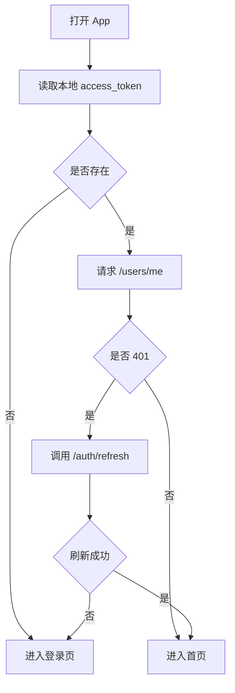
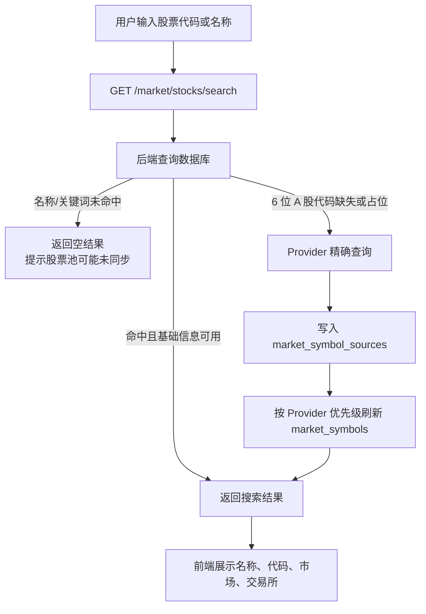
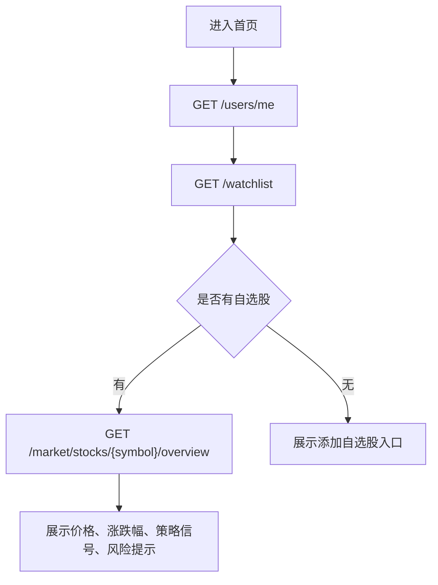
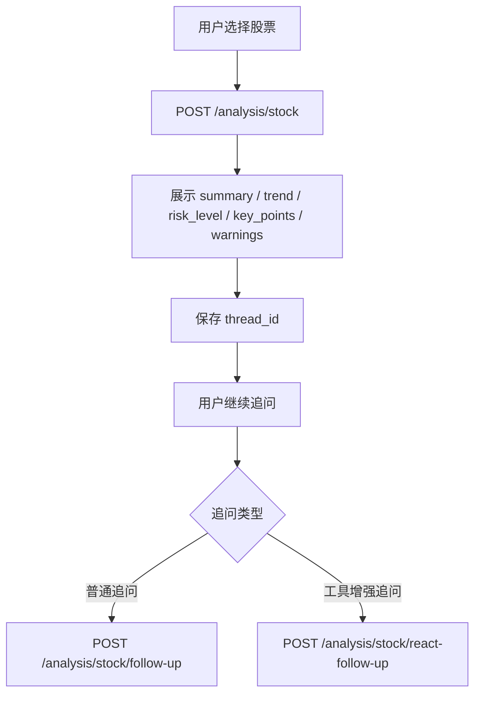
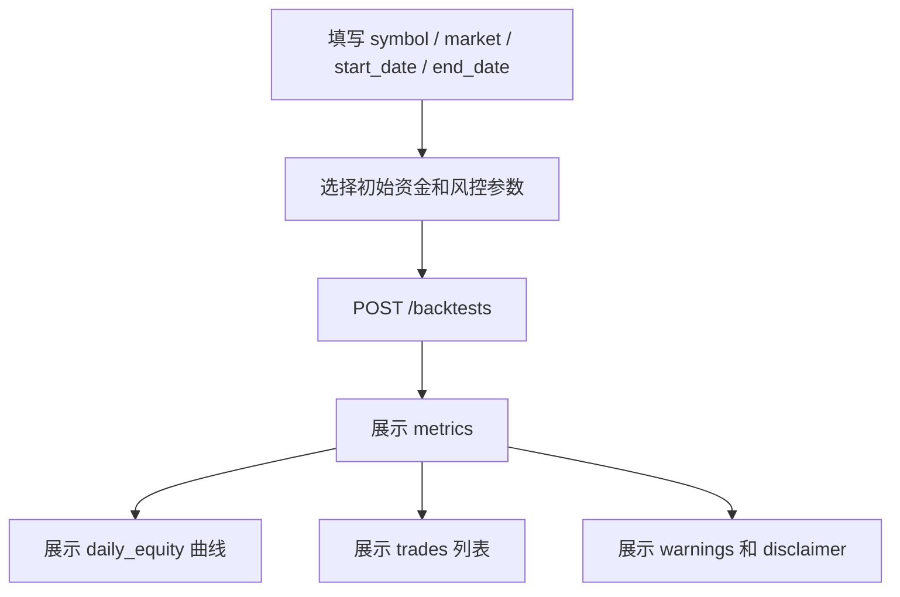
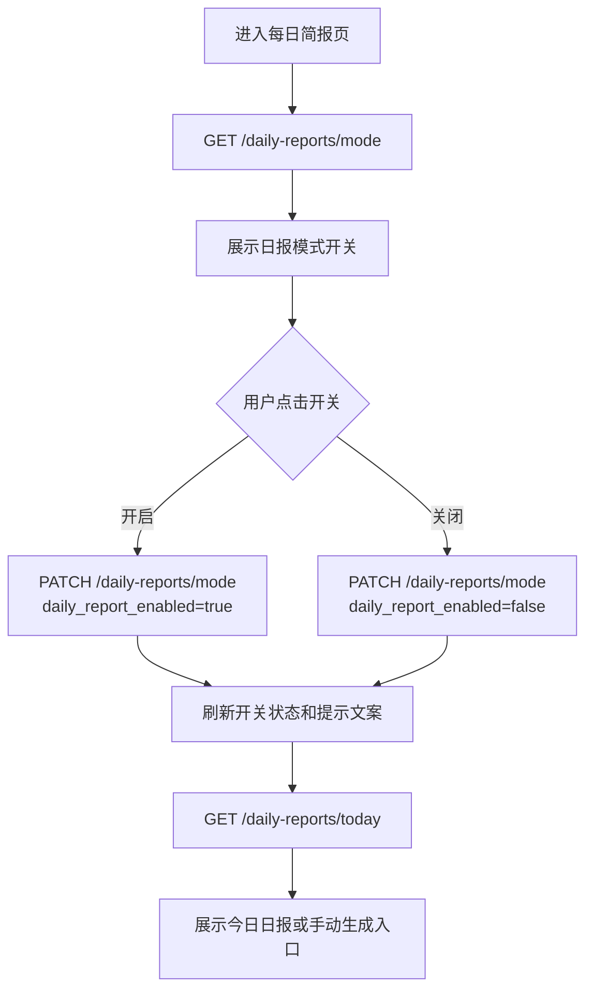
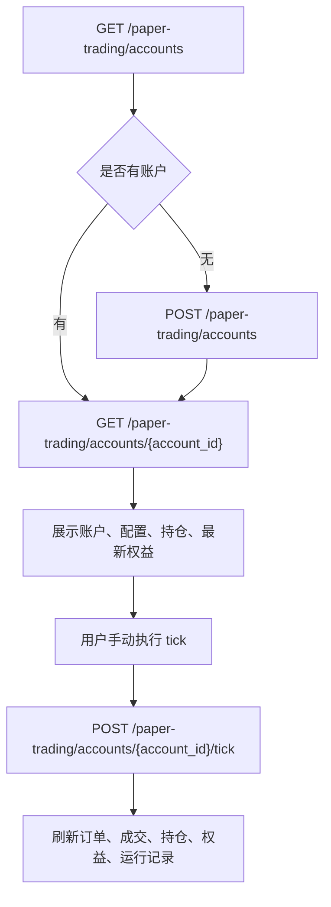

# 前端对接指南

本文面向 Android / Web 前端开发，说明如何接入当前后端 API。

## 一、基础地址

后端统一 API 前缀：

```text
/api/v1
```

本地开发常见地址：

```text
http://127.0.0.1:8000/api/v1
```

生产部署第一版通过 Nginx 暴露 HTTP 80 端口。实际公网 IP 或域名应以部署环境为准。

## 二、统一响应格式

成功响应外层结构：

```json
{
  "code": 0,
  "message": "success",
  "data": {}
}
```

错误响应外层结构：

```json
{
  "code": 40001,
  "message": "error message",
  "details": [
    {
      "field": "email",
      "reason": "invalid email"
    }
  ]
}
```

前端处理建议：

| 字段 | 含义 | 前端处理 |
| ---- | ---- | -------- |
| `code` | 业务状态码，`0` 表示成功 | 非 0 时走错误提示 |
| `message` | 响应说明 | 可展示给用户或用于调试 |
| `data` | 真实业务数据 | 页面渲染使用 |
| `details` | 字段级错误列表 | 表单错误提示使用 |

## 三、登录和 Token

登录成功后，后端返回：

```json
{
  "access_token": "...",
  "refresh_token": "...",
  "token_type": "bearer"
}
```

需要登录的接口请求头：

```http
Authorization: Bearer <access_token>
```

推荐 App 登录流程：



退出登录建议：

```text
1. 调用 POST /auth/logout；
2. 本地删除 access_token 和 refresh_token；
3. 跳转登录页。
```

## 四、常见 HTTP 状态处理

| 状态 | 常见原因 | 前端处理 |
| ---- | -------- | -------- |
| 200 / 201 | 请求成功 | 读取 `data` |
| 400 | 请求参数或业务规则错误 | 展示 `message` 和 `details` |
| 401 | token 缺失、过期、被注销 | 尝试刷新 token，失败后重新登录 |
| 403 | 无权限 | 提示无权限 |
| 404 | 资源不存在或不属于当前用户 | 提示资源不存在 |
| 422 | Pydantic 参数校验失败 | 表单字段提示 |
| 500 | 服务端异常 | 提示稍后重试 |

## 五、页面与接口映射

| 页面 | 推荐接口 |
| ---- | -------- |
| 注册页 | `POST /api/v1/auth/register` |
| 登录页 | `POST /api/v1/auth/login` |
| 我的页面 | `GET /api/v1/users/me`、`PATCH /api/v1/users/me` |
| 设置页 | `GET /api/v1/preferences/me`、`PATCH /api/v1/preferences/me` |
| 自选股页 | `GET /api/v1/watchlist`、`POST /api/v1/watchlist` |
| 股票搜索页 | `GET /api/v1/market/stocks/search` |
| 股票详情页 | `GET /api/v1/market/stocks/{symbol}/overview` |
| 技术指标页 | `GET /api/v1/technical-indicators/stocks/{symbol}/summary` |
| AI 分析页 | `POST /api/v1/analysis/stock` |
| AI 追问页 | `POST /api/v1/analysis/stock/follow-up`、`POST /api/v1/analysis/stock/react-follow-up` |
| 分析历史页 | `GET /api/v1/analysis-records` |
| 单股回测页 | `POST /api/v1/backtests` |
| 组合回测页 | `POST /api/v1/portfolio-backtests` |
| 候选评分页 | `POST /api/v1/stock-candidates` |
| 每日简报页 | `GET /api/v1/daily-reports/mode`、`PATCH /api/v1/daily-reports/mode`、`GET /api/v1/daily-reports/today`、`GET /api/v1/daily-reports` |
| 量化提醒页 | `GET /api/v1/quant-alerts/rules`、`GET /api/v1/quant-alerts/events` |
| 纸面交易页 | `GET /api/v1/paper-trading/accounts`、`POST /api/v1/paper-trading/accounts/{account_id}/tick` |

### 股票搜索页建议数据流

`GET /api/v1/market/stocks/search` 已经由后端统一编排数据库查询和少量 Provider 精确兜底。

前端不需要在搜索无结果时自行调用 `/market-sync/symbols/{symbol}` 后再重新搜索。当前后端会：

```text
1. 优先查询 market_symbols；
2. 名称 / 关键词搜索只读取数据库股票池，不在用户请求中高频调用 Tushare；
3. 数据库命中但名称为空、名称等于代码或来源仍是 mock，并且搜索词是 6 位 A 股代码时，才尝试 Provider 精确刷新；
4. 数据库无结果且搜索词是 6 位 A 股代码时，才调用配置的精确查询 Provider 补齐基础信息；
5. Provider 返回的基础信息会先写入 market_symbol_sources，再按 Provider 优先级刷新 market_symbols；
6. 返回统一搜索结果给前端，结果包含 symbol、name、market、exchange、currency、source。
```



股票基础信息池由后端通过 `POST /market-sync/symbol-pool` 或 Celery Beat 定时任务维护。Tushare 更适合低频股票池同步，BaoStock 更适合精确代码补齐和 K 线同步；前端不需要知道当前使用哪个 Provider。

股票详情页调用 `GET /api/v1/market/stocks/{symbol}/overview` 时，如果该股票基础信息已存在但 K 线尚未入库，后端会尝试按当前 Provider 同步所需 K 线后再返回详情。前端不需要自行调用 `/market-sync/stocks/{symbol}/candles`。

## 六、首页建议数据流



## 七、AI 分析页建议数据流



前端展示注意：

```text
1. `graph_route` 为 unavailable / error 时，要优先展示数据不可用说明；
2. `quality_context.warnings` 和 `result.warnings` 应作为风险提示展示；
3. 页面上应保留“不构成投资建议”的提示。
```

## 八、回测页建议数据流



重要说明：

```text
回测只基于历史 K 线和规则模拟；
历史表现不代表未来；
前端不要把回测结果展示为收益承诺。
```

## 九、每日简报页模式开关数据流

前端进入每日简报页时，建议先读取日报模式状态：



响应中的 `scheduler_enabled` 只表示服务端是否启用了全局 Celery Beat 日报调度。前端按钮只能控制当前用户的 `daily_report_enabled`，不能控制服务器定时器。

如果 `effective_status` 为 `enabled_but_scheduler_off`，前端可以提示：

```text
日报模式已开启，但当前服务器未启用自动调度。你仍可以手动生成日报。
```

## 十、纸面交易页建议数据流



纸面交易必须展示：

```text
纸面交易仅用于研究和学习，不是真实交易，不构成投资建议，也不承诺未来收益。
```

## 十一、Android 客户端实现建议

| 能力 | 建议 |
| ---- | ---- |
| Token 存储 | 使用安全存储保存 `access_token` 和 `refresh_token` |
| 网络层 | 统一封装 base URL、Authorization Header、错误处理 |
| 401 处理 | 拦截 401 后自动 refresh，一次失败后跳登录 |
| 金额和比例 | 后端部分金额为 Decimal，前端按字符串或高精度类型处理更安全 |
| 时间字段 | 后端返回 ISO datetime，前端统一转本地时区展示 |
| 风险提示 | AI、策略、回测、纸面交易页面固定展示免责声明 |
