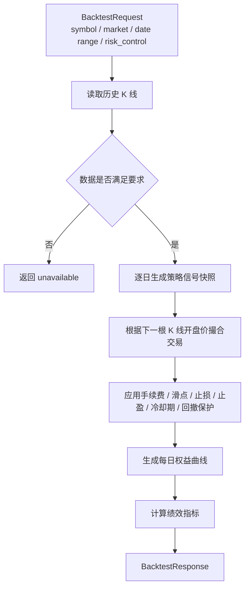
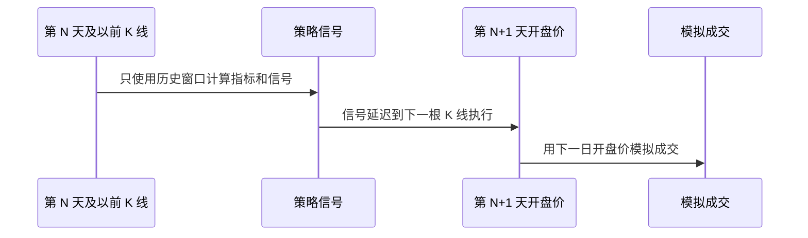
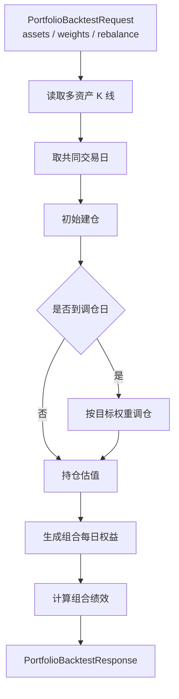

# 回测业务介绍

本文介绍单股回测和组合回测的业务流程、参数、指标和风险边界。

相关代码：

```text
backend/app/services/backtest_service.py
backend/app/services/backtest_query_service.py
backend/app/services/backtest_data_service.py
backend/app/services/portfolio_backtest_service.py
backend/app/services/portfolio_backtest_query_service.py
backend/app/schemas/backtest.py
backend/app/schemas/portfolio_backtest.py
```

## 一、回测边界

回测只基于历史 K 线和确定性规则模拟：

```text
不连接券商；
不真实下单；
不构成投资建议；
不代表未来收益；
历史表现不能外推为未来收益承诺。
```

## 二、单股回测总体流程



## 三、单股回测请求参数

| 字段 | 默认 | 说明 |
| ---- | ---- | ---- |
| `symbol` | 必填 | 股票代码 |
| `market` | 必填 | `US`、`CN`、`HK` |
| `start_date` | 必填 | 开始日期 |
| `end_date` | 必填 | 结束日期 |
| `timeframe` | `1d` | K 线周期 |
| `initial_cash` | `100000` | 初始资金 |
| `position_size_ratio` | `1.0` | 单次买入使用资金比例 |
| `risk_control` | 默认多数关闭 | 风控配置 |
| `adjust_type` | `none` | 复权类型 |
| `source` | 可选 | 数据来源 |
| `min_required_candles` | `60` | 最少 K 线数量 |
| `enforce_data_quality` | `true` | 是否强制数据质量 |
| `include_trades` | `true` | 是否返回交易列表 |
| `include_daily_equity` | `true` | 是否返回每日权益 |
| `include_signal_snapshots` | `false` | 是否返回每日信号快照 |

## 四、风控参数

| 字段 | 说明 |
| ---- | ---- |
| `commission_rate` | 手续费率 |
| `min_commission` | 最低手续费 |
| `slippage_rate` | 滑点率 |
| `stop_loss_rate` | 止损比例 |
| `take_profit_rate` | 止盈比例 |
| `cooldown_days` | 卖出后冷却天数 |
| `max_drawdown_guard_rate` | 最大回撤保护阈值 |
| `enable_stop_loss` | 是否启用止损 |
| `enable_take_profit` | 是否启用止盈 |
| `enable_cooldown` | 是否启用冷却期 |
| `enable_max_drawdown_guard` | 是否启用最大回撤保护 |

## 五、信号生成和未来函数规避

单股回测逐日遍历 K 线：

```text
第 N 天信号只使用第 1 天到第 N 天的历史 K 线；
如果历史窗口少于 MIN_SIGNAL_WINDOW = 35，则跳过；
第 N 天收盘后生成信号；
交易在第 N+1 天开盘价模拟成交。
```

这样做是为了避免“偷看未来”。



## 六、交易撮合

买入逻辑：

```text
1. 当前为空仓；
2. 决策为 buy；
3. 使用下一根 K 线开盘价；
4. 如果启用滑点，买入价 = open_price * (1 + slippage_rate)；
5. 按 position_size_ratio 计算可买整数股；
6. 扣除成交金额和手续费；
7. 更新现金和持仓。
```

卖出逻辑：

```text
1. 当前有持仓；
2. 决策为 sell / stop_loss / take_profit；
3. 使用下一根 K 线开盘价；
4. 如果启用滑点，卖出价 = open_price * (1 - slippage_rate)；
5. 卖出全部持仓；
6. 扣除手续费；
7. 计算 realized_pnl 和 realized_return。
```

手续费：

```text
commission = max(trade_value * commission_rate, min_commission)
```

滑点：

```text
买入成交价 = 原始开盘价 * (1 + slippage_rate)
卖出成交价 = 原始开盘价 * (1 - slippage_rate)
```

## 七、风控执行顺序

每个交易日会按顺序应用：

```text
止损
止盈
最大回撤保护
冷却期
买卖撮合
```

说明：

| 风控 | 行为 |
| ---- | ---- |
| 止损 | 当前收盘价跌破买入价按比例计算的触发价时，改写为 `stop_loss` |
| 止盈 | 当前收盘价高于买入价按比例计算的触发价时，改写为 `take_profit` |
| 最大回撤保护 | 空仓准备买入且账户回撤超过阈值时，跳过买入 |
| 冷却期 | 卖出后若仍处于冷却期，拦截新的 buy 信号 |

## 八、每日权益

每日权益计算：

```text
position_market_value = position_quantity * close_price
total_equity = cash + position_market_value
daily_return = total_equity_today / total_equity_yesterday - 1
drawdown = (peak_equity - total_equity) / peak_equity
```

前端可以用 `daily_equity` 画资金曲线、回撤曲线和持仓变化。

## 九、绩效指标

| 指标 | 含义 |
| ---- | ---- |
| `total_return` | 总收益率 |
| `annualized_return` | 年化收益率 |
| `average_daily_return` | 平均日收益 |
| `max_drawdown` | 最大回撤 |
| `daily_return_volatility` | 日收益波动率 |
| `annualized_volatility` | 年化波动率 |
| `sharpe_ratio` | 夏普比率 |
| `return_drawdown_ratio` | 收益回撤比 |
| `trade_count` | 总交易次数 |
| `win_rate` | 胜率 |
| `profit_loss_ratio` | 盈亏比 |
| `buy_and_hold_return` | 买入持有收益 |
| `excess_return` | 相对买入持有的超额收益 |
| `total_commission` | 总手续费 |
| `total_slippage_cost` | 总滑点成本 |

## 十、组合回测

组合回测用于模拟多只资产按目标权重构建组合并定期调仓。



组合回测请求重点：

| 字段 | 说明 |
| ---- | ---- |
| `assets` | 2 到 20 个资产 |
| `target_weight` | 每个资产目标权重，总和必须为 1 |
| `cash_deploy_ratio` | 投入资金比例 |
| `rebalance_frequency` | 调仓频率 |
| `rebalance_interval_days` | 自定义间隔调仓天数 |

调仓频率：

```text
none
daily
weekly
monthly
interval
```

## 十一、前端展示建议

| 区域 | 展示内容 |
| ---- | -------- |
| 参数区 | symbol、market、日期、资金、风控配置 |
| 结果摘要 | summary、disclaimer、warnings |
| 指标卡片 | 总收益率、最大回撤、胜率、交易次数、夏普比率 |
| 图表 | daily_equity 资金曲线、drawdown 回撤曲线 |
| 交易列表 | trades |
| 信号调试 | signal_snapshots，可做高级模式 |

必须展示：

```text
本回测仅基于历史行情和策略规则进行模拟，不构成投资建议，也不代表未来收益。
```

