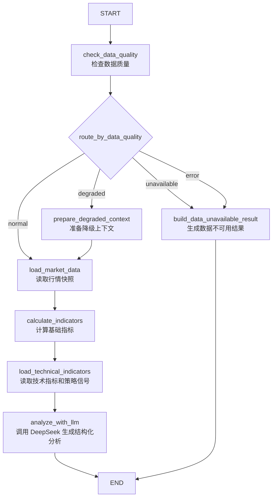
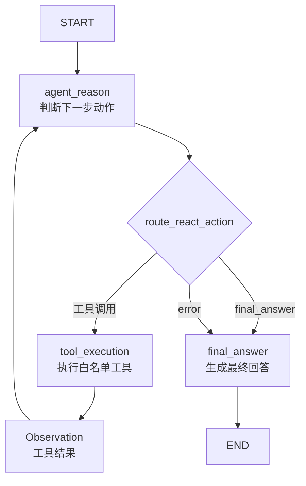
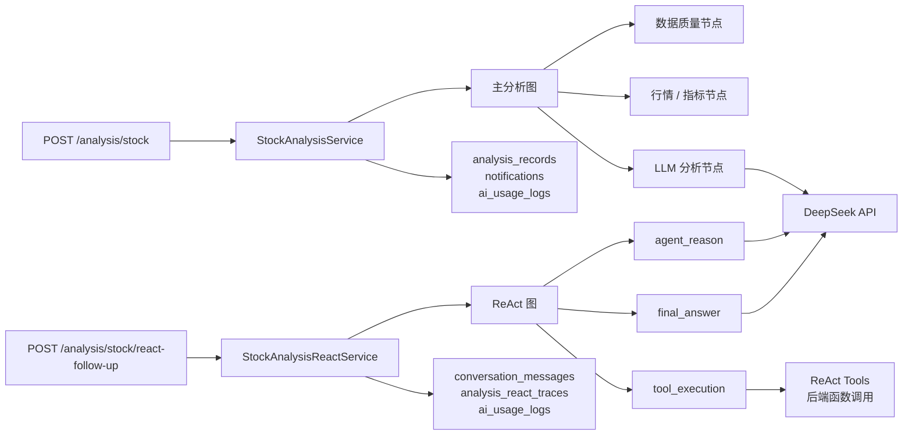

# 图结构介绍

本文介绍后端当前两个 LangGraph 图：主分析图和 ReAct 追问图。

相关代码：

```text
backend/app/graphs/stock_analysis_graph.py
backend/app/graphs/stock_analysis_react_graph.py
backend/app/graphs/nodes.py
backend/app/graphs/react_nodes.py
backend/app/graphs/routers.py
backend/app/graphs/react_routers.py
backend/app/graphs/states.py
backend/app/graphs/react_states.py
backend/app/graphs/react_tools.py
```

## 一、为什么使用 LangGraph

普通 LLM 调用通常是：

```text
输入 prompt -> LLM -> 输出文本
```

本项目不能这样简单处理股票分析，因为股票分析需要：

```text
检查数据质量；
读取行情；
计算技术指标；
读取策略信号；
判断是否允许调用 LLM；
在数据不可用时安全降级；
保存分析记录；
支持后续追问；
记录工具调用 trace。
```

LangGraph 的作用是把这些步骤组织成可控的状态流转。

## 二、主分析图

主分析图负责一次完整个股 AI 分析。

入口函数：

```text
arun_stock_analysis_graph(initial_state, thread_id=...)
```

主要调用方：

```text
StockAnalysisService
```

主分析图不是直接把用户输入丢给 LLM，而是先做数据质量判断，再决定路线。



## 三、主分析图节点说明

| 节点 | 作用 | 是否调用 LLM |
| ---- | ---- | ------------ |
| `check_data_quality` | 检查 K 线是否为空、数量不足、过旧或有错误 | 否 |
| `prepare_degraded_context` | 数据可用但有风险时，准备降级上下文 | 否 |
| `build_data_unavailable_result` | 数据不可用或出错时构造安全结果 | 否 |
| `load_market_data` | 读取行情快照 | 否 |
| `calculate_indicators` | 计算兼容早期逻辑的基础指标 | 否 |
| `load_technical_indicators` | 读取完整技术指标和策略信号 | 否 |
| `analyze_with_llm` | 调用 DeepSeek 生成结构化分析 | 是 |

## 四、主分析图路线

| 路线 | 触发条件 | 行为 |
| ---- | -------- | ---- |
| `normal` | 数据质量可用 | 完整读取行情、指标、策略信号，然后调用 LLM |
| `degraded` | 数据可用但有风险 | 携带数据风险提示进入 LLM 分析 |
| `unavailable` | 数据为空或无法满足最低要求 | 不调用 LLM，直接返回不可用结果 |
| `error` | 数据质量检查或图执行出现错误 | 不调用 LLM，直接返回安全结果 |
| `quota_blocked` | AI 额度不足 | 阻止 LLM 调用，返回额度相关结果 |

这套路线的核心目的是：

```text
避免在行情缺失、过旧或质量不足时让 AI 编造分析。
```

## 五、主分析图状态

主分析图状态大致包含：

| 字段 | 含义 |
| ---- | ---- |
| `user_id` | 当前用户 |
| `symbol` | 股票代码 |
| `market` | 市场 |
| `analysis_type` | 分析类型 |
| `thread_id` | 分析线程 ID |
| `risk_preference` | 用户风险偏好 |
| `graph_route` | 当前路线 |
| `quality_context` | 数据质量上下文 |
| `market_snapshot` | 行情快照 |
| `indicators` | 基础指标 |
| `technical_indicators` | 完整技术指标 |
| `strategy_signal` | 策略信号 |
| `user_profile_context` | 用户画像上下文 |
| `relevant_memories_context` | 相关记忆上下文 |
| `result` | LLM 结构化分析结果 |
| `record_id` | 分析记录 ID |
| `notification_id` | 通知 ID |
| `error_message` | 错误信息 |

## 六、ReAct 追问图

ReAct 图负责已有分析线程上的工具增强追问。

入口函数：

```text
arun_stock_analysis_react_graph(initial_state, tool_service=...)
```

主要调用方：

```text
StockAnalysisReactService
```

ReAct 图的核心循环：



## 七、ReAct 工具白名单

当前 ReAct 图允许的工具：

| 工具 | 作用 |
| ---- | ---- |
| `get_analysis_record` | 读取当前分析记录 |
| `get_market_overview` | 获取行情 overview |
| `get_technical_indicators` | 获取技术指标 |
| `get_data_quality` | 获取数据质量报告 |
| `get_user_preference` | 获取用户偏好 |
| `get_watchlist` | 获取当前用户自选股 |
| `get_backtest_result` | 获取回测结果 |
| `get_stock_candidates` | 获取候选评分 |

重要边界：

```text
ReAct 工具不是公网 API；
用户不能直接调用这些工具；
工具由后端在当前用户隔离、白名单和 max_iterations 限制下执行；
工具结果会作为 Observation 回到图中继续推理。
```

## 八、ReAct 状态与 trace

ReAct 状态中常见字段：

| 字段 | 含义 |
| ---- | ---- |
| `analysis_thread_id` | 原始分析线程 |
| `react_graph_checkpoint_id` | 本次 ReAct 图 checkpoint ID |
| `message` | 用户追问 |
| `allowed_tools` | 可用工具列表 |
| `observations` | 工具返回结果 |
| `trace` | 推理和工具调用轨迹 |
| `iteration_count` | 已执行轮数 |
| `max_iterations` | 最大工具循环次数，当前默认 3 |
| `final_answer` | 最终回答 |

`max_iterations` 的作用是避免模型反复调用工具导致成本失控。

## 九、两个图与 API 的关系



## 十、前端关注点

前端通常不需要理解图内部所有状态，但需要关注：

| 字段 | 页面用途 |
| ---- | -------- |
| `thread_id` | 后续普通追问和 ReAct 追问必须保存 |
| `graph_route` | 判断是否正常展示分析结果 |
| `quality_context` | 展示数据质量风险 |
| `result.warnings` | 展示 AI 风险提示 |
| `used_tools` / `observations` / `trace` | ReAct 调试页或高级详情页可展示 |

建议：

```text
普通用户页面只展示 answer、warnings 和关键 observation；
开发调试页面再展示完整 trace。
```

