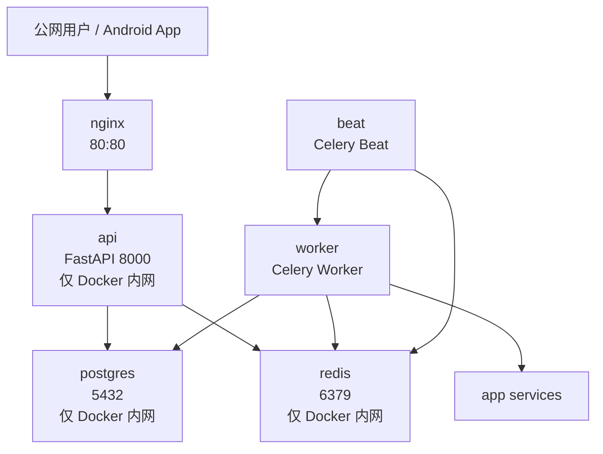

# 部署与环境说明

本文说明后端当前生产部署结构、环境变量边界和安全注意事项。

相关文件：

```text
backend/Dockerfile
backend/docker-compose.prod.yml
backend/nginx/conf.d/default.conf
backend/.env.example
backend/.env.test.example
backend/.env.production.example
backend/.github/workflows/deploy.yml
```

## 一、生产部署目标

当前第一版生产部署目标：

```text
腾讯云轻量服务器
Ubuntu 22.04
Docker Compose 单机部署
HTTP + IP 访问
暂不配置域名和 HTTPS
```

生产服务包括：

```text
postgres
redis
api
worker
beat
nginx
```

## 二、生产架构



## 三、端口边界

| 服务 | 容器端口 | 是否公网暴露 | 说明 |
| ---- | -------- | ------------ | ---- |
| nginx | 80 | 是 | 唯一 HTTP 公网入口 |
| api | 8000 | 否 | 只通过 Docker 内网给 nginx 访问 |
| postgres | 5432 | 否 | 只允许 Docker 内网访问 |
| redis | 6379 | 否 | 只允许 Docker 内网访问 |
| SSH | 22 | 是 | 服务器运维入口 |

安全原则：

```text
公网只开放 80 和 22；
不要开放 8000、5432、6379；
Nginx 转发到 Docker 内网 api:8000。
```

## 四、服务说明

| 服务 | 职责 |
| ---- | ---- |
| `postgres` | 保存用户、分析记录、行情、K 线、回测、日报、提醒、纸面交易等业务数据 |
| `redis` | 缓存、Celery Broker、Celery Result Backend |
| `api` | FastAPI 后端服务 |
| `worker` | 执行耗时后台任务，如行情同步、日报、量化提醒、纸面交易 tick |
| `beat` | 定时任务调度器，只负责提交任务 |
| `nginx` | 反向代理公网请求到 api |

日报调度边界：

```text
前端只能通过 /daily-reports/mode 控制当前用户的 daily_report_enabled；
是否真正自动提交日报任务，还取决于服务端 Celery Beat 日报调度配置；
Celery Beat 提交日报任务时，只会扫描已开启 daily_report_enabled 的活跃用户；
用户关闭日报模式后，不影响历史日报查询，也不影响手动生成日报。
```

## 五、环境变量文件

| 文件 | 用途 | 是否可提交 |
| ---- | ---- | ---------- |
| `.env.example` | 本地开发模板 | 可以 |
| `.env.test.example` | 测试环境模板 | 可以 |
| `.env.production.example` | 生产环境模板，只有占位符 | 可以 |
| `.env` | 本地真实配置 | 不建议提交 |
| `.env.test` | 本地测试真实配置 | 不建议提交 |
| `.env.production` | 生产真实配置 | 禁止提交 |

禁止提交：

```text
DeepSeek Key
JWT_SECRET_KEY
数据库密码
Tushare Token
SSH 私钥
.env.production
```

## 六、关键配置说明

| 配置 | 说明 |
| ---- | ---- |
| `APP_ENV_FILE` | 指定读取哪个 env 文件 |
| `DATABASE_ASYNC_URL` | 异步 PostgreSQL 连接 |
| `REDIS_URL` | Redis 缓存连接 |
| `CELERY_BROKER_URL` | Celery Broker |
| `CELERY_RESULT_BACKEND` | Celery 结果后端 |
| `JWT_SECRET_KEY` | JWT 签名密钥，生产必须强随机 |
| `AUTH_SINGLE_SESSION_PER_DEVICE_CATEGORY_ENABLED` | 是否启用同类设备单会话控制，生产建议开启 |
| `AUTH_SINGLE_SESSION_UNKNOWN_CATEGORY_ENABLED` | `unknown` 设备类别是否参与互踢，旧客户端兼容期建议关闭 |
| `AUTH_ACCESS_TOKEN_SESSION_CHECK_ENABLED` | 鉴权时是否校验服务端 session 状态，生产建议开启 |
| `AUTH_BLACKLIST_REPLACED_ACCESS_TOKEN` | 新同类设备登录替换旧 session 时，是否同步拉黑旧 access token jti |
| `DEEPSEEK_API_KEY` | DeepSeek API Key |
| `LLM_PROVIDER` | LLM Provider |
| `MARKET_DATA_PRIMARY_PROVIDER` | 主行情 Provider |
| `MARKET_DATA_FALLBACK_PROVIDERS` | fallback Provider 配置预留 |
| `MARKET_SYMBOL_PRIMARY_PROVIDER` | 统一股票基础信息表的优先 Provider，默认 Tushare 优先 |
| `MARKET_SYMBOL_FALLBACK_PROVIDERS` | 股票基础信息备用 Provider 优先级，例如 `baostock,mock` |
| `MARKET_SYMBOL_SYNC_PROVIDER` | 股票池低频同步使用的 Provider，生产可配置为 `tushare` |
| `MARKET_SYMBOL_EXACT_LOOKUP_PROVIDER` | 用户搜索 6 位 A 股代码缺失时的精确补齐 Provider，生产可配置为 `baostock` |
| `CELERY_BEAT_MARKET_SYMBOL_SYNC_ENABLED` | 是否启用股票基础信息池定时同步 |
| `CELERY_BEAT_MARKET_SYMBOL_SYNC_LIMIT` | 股票池同步数量上限；留空表示全量拉取，生产建议留空 |
| `CELERY_BEAT_WATCHLIST_CANDLE_SYNC_ENABLED` | 是否启用自选股 K 线定时同步任务 |
| `CELERY_BEAT_WATCHLIST_CANDLE_SYNC_HOUR` | 自选股 K 线同步每天执行小时 |
| `CELERY_BEAT_WATCHLIST_CANDLE_SYNC_MINUTE` | 自选股 K 线同步每天执行分钟 |
| `CELERY_BEAT_WATCHLIST_CANDLE_SYNC_MARKET` | 自选股 K 线同步市场，默认 `CN` |
| `CELERY_BEAT_WATCHLIST_CANDLE_SYNC_TIMEFRAME` | K 线周期，当前主链路使用 `1d` |
| `CELERY_BEAT_WATCHLIST_CANDLE_SYNC_LIMIT` | 每只股票同步的 K 线数量 |
| `CELERY_BEAT_WATCHLIST_CANDLE_SYNC_ADJUST_TYPE` | 复权类型，例如 `none` |
| `CELERY_BEAT_WATCHLIST_CANDLE_SYNC_SOURCE` | 自选股 K 线同步主 Provider，生产可使用 `baostock` |
| `CELERY_BEAT_WATCHLIST_CANDLE_SYNC_FALLBACK_SOURCES` | 主 Provider 失败后的备用 Provider 列表，逗号分隔 |
| `CELERY_BEAT_WATCHLIST_CANDLE_SYNC_MAX_SYMBOLS` | 单次任务最多处理多少只自选股 |
| `CELERY_BEAT_WATCHLIST_CANDLE_SYNC_BATCH_SIZE` | 批处理大小 |
| `CELERY_BEAT_WATCHLIST_CANDLE_SYNC_STALE_AFTER_DAYS` | K 线超过多少天未更新才重新同步 |
| `CELERY_BEAT_WATCHLIST_CANDLE_SYNC_MAX_RETRIES` | 后台任务失败后的最大重试次数 |

注意：`MARKET_DATA_FALLBACK_PROVIDERS` 已用于单股回测缺失数据补齐；自选股定时同步使用独立的 `CELERY_BEAT_WATCHLIST_CANDLE_SYNC_FALLBACK_SOURCES`。并非所有行情查询接口都自动遍历 fallback，前端仍不应自行编排 Provider。


生产环境建议使用 `CELERY_TIMEZONE=Asia/Shanghai`，并将自选股日 K 同步设为每天上海时间 01:00。若要求每日都尝试刷新，应设置 `CELERY_BEAT_WATCHLIST_CANDLE_SYNC_STALE_AFTER_DAYS=0`；重复日期由数据库 upsert 幂等处理，不会重复插入 K 线。

自选股 K 线同步边界：
```text
K 线数据不做全市场全量同步，只允许同步自选股、最近分析过的股票或明确指定的股票。
当前定时任务 watchlist_candle_sync 会扫描 watchlist_items 中的去重股票池，按 stale_after_days 判断是否需要刷新。
单只股票同步失败不会中断整个批次，任务结果会记录成功、跳过、失败和 fallback 使用情况。
```
股票基础信息同步边界：

```text
股票基础信息可以通过 Tushare 等 Provider 低频全量同步；
K 线数据不能做全市场全量同步，只能同步自选股、最近分析过的股票或明确指定的股票；
用户名称搜索主要读取数据库股票池，不应高频调用 Tushare；
BaoStock 可作为精确代码补齐和 K 线同步来源，但不能无脑覆盖 Tushare 的高优先级基础信息。
```

## 七、常用命令

进入后端目录：

```powershell
cd F:\study\project\python_project\ai_project\langgraph_commerce\backend
```

本地开发启动：

```powershell
uv run uvicorn app.main:app --reload
```

查看 Docker 服务：

```powershell
docker compose ps
```

检查生产 compose 配置：

```powershell
docker compose --env-file .env.production.example -f docker-compose.prod.yml config --quiet
```

检查 Alembic 当前版本：

```powershell
uv run alembic current
```

测试环境常用变量：

```powershell
$env:APP_ENV_FILE='.env.test'
$env:UV_CACHE_DIR='.uv-cache'
```

基础检查：

```powershell
uv run python -m compileall app
uv run python -m compileall tests
uv run pytest tests/test_smoke.py -q
```

## 八、部署注意事项

### 1. Nginx 和 API 容器解析

Docker 重新创建 api 容器后，Nginx 可能仍指向旧的 Docker 内网解析。遇到公网健康检查失败但 api 容器正常时，可以重启 nginx 或整个 compose。

### 2. Docker config 警告

本机 Windows 环境执行 Docker Compose 校验时，可能出现：

```text
C:\Users\86183\.docker\config.json Access denied
```

如果命令退出码为 0，通常表示 compose 配置解析仍通过。

### 3. Git dubious ownership

Windows 下 Git 可能提示 dubious ownership，可临时使用：

```powershell
git -c safe.directory=F:/study/project/python_project/ai_project/langgraph_commerce/backend status --short
```

## 九、后续优化方向

| 方向 | 说明 |
| ---- | ---- |
| HTTPS | 后续有域名和备案后配置 HTTPS |
| 自动备份 | 为 PostgreSQL 增加 pg_dump 备份和恢复演练 |
| 监控告警 | 增加磁盘、CPU、内存、容器健康、日志告警 |
| API 限流 | 对 AI、回测、候选评分、日报等重接口限流 |
| SSH 加固 | 密钥登录、禁用密码登录、限制登录来源 |
| CI 增强 | 当前偏 CD，后续补充完整 CI 测试矩阵 |
| Provider fallback | 完善真实行情 Provider 自动降级链路 |

## 十、前端部署对接说明

Android / Web 前端只应访问 Nginx 公网入口：

```text
http://<server-ip>/api/v1
```

前端不应直接访问：

```text
http://<server-ip>:8000
postgres:5432
redis:6379
```

如果后续配置 HTTPS，前端 base URL 应切换为：

```text
https://<domain>/api/v1
```
