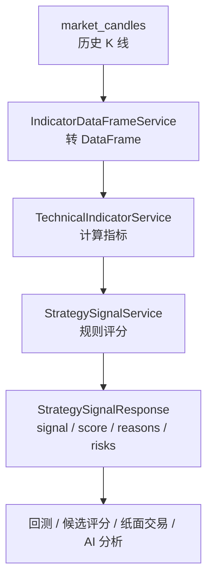
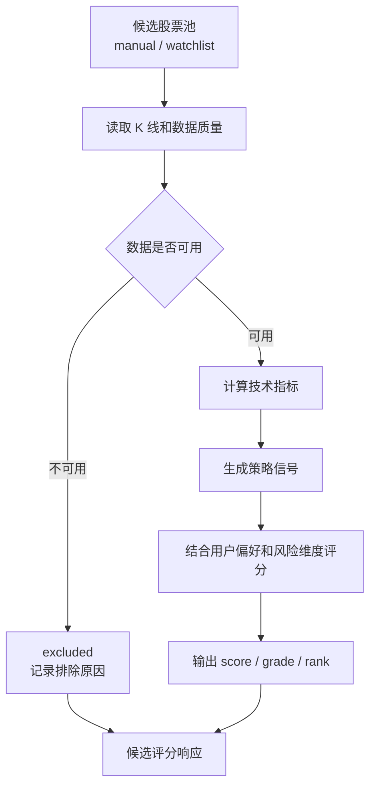

# 量化策略介绍

本文介绍后端当前的技术指标、策略信号和候选评分思路。它们都属于研究辅助工具，不构成投资建议。

相关代码：

```text
backend/app/services/technical_indicator_service.py
backend/app/services/technical_indicator_query_service.py
backend/app/services/strategy_signal_service.py
backend/app/services/strategy_signal_query_service.py
backend/app/services/stock_candidate_scoring_service.py
```

## 一、总体数据流



## 二、K 线数据

指标计算主要依赖：

| 字段 | 含义 |
| ---- | ---- |
| `open_price` | 开盘价 |
| `high_price` | 最高价 |
| `low_price` | 最低价 |
| `close_price` | 收盘价 |
| `volume` | 成交量 |
| `candle_time` | K 线时间 |

所有指标都基于历史 K 线计算。样本不足时，部分指标会返回 `None`，后续策略规则会降低信号可信度。

## 三、均线 MA / EMA

简单移动均线：

```text
MA_N = 最近 N 根 K 线收盘价之和 / N
```

指数移动均线：

```text
EMA_today = Close_today * alpha + EMA_yesterday * (1 - alpha)
alpha = 2 / (N + 1)
```

当前计算：

| 指标 | 用途 |
| ---- | ---- |
| `ma5` | 短期均线 |
| `ma10` | 中短期均线 |
| `ma20` | 中期均线 |
| `ma60` | 中长期均线 |
| `ema12` | MACD 快线基础 |
| `ema26` | MACD 慢线基础 |

趋势判断：

```text
latest_close > ma5 > ma20  或 latest_close > ma20 > ma60 -> bullish
latest_close < ma5 < ma20  或 latest_close < ma20 < ma60 -> bearish
其他 -> neutral
```

## 四、RSI

RSI 用于观察超买超卖：

```text
RS = 平均上涨幅度 / 平均下跌幅度
RSI = 100 - 100 / (1 + RS)
```

当前计算：

| 指标 | 说明 |
| ---- | ---- |
| `rsi6` | 短周期 RSI |
| `rsi12` | 主参考 RSI |
| `rsi24` | 长一点的 RSI |

分类：

```text
RSI >= 70 -> overbought
RSI <= 30 -> oversold
其他 -> neutral
```

解释边界：

```text
超卖不等于一定反弹；
超买不等于一定下跌；
RSI 只是策略评分因子之一。
```

## 五、MACD

当前参数使用常见组合 12 / 26 / 9。

```text
DIF = EMA12 - EMA26
DEA = DIF 的 9 期 EMA
histogram = 2 * (DIF - DEA)
```

分类：

```text
DIF > DEA 且 histogram > 0 -> bullish
DIF < DEA 且 histogram < 0 -> bearish
其他 -> neutral
```

## 六、波动率

日收益率：

```text
daily_return = close_today / close_yesterday - 1
```

日收益率标准差：

```text
daily_return_std = std(daily_return)
```

年化波动率：

```text
annualized_volatility = daily_return_std * sqrt(252)
```

分类：

```text
annualized_volatility >= 0.4 -> high
annualized_volatility >= 0.2 -> medium
其他 -> low
```

波动率主要用于风险维度，不用于单独生成买卖方向。

## 七、动量

动量计算：

```text
momentum_N = 最新收盘价 - N 根前收盘价
```

当前计算：

| 指标 | 说明 |
| ---- | ---- |
| `momentum_5` | 5 根 K 线动量 |
| `momentum_10` | 10 根 K 线动量 |
| `momentum_20` | 20 根 K 线动量 |

方向判断：

```text
优先看 momentum_20，其次 momentum_10，再其次 momentum_5
> 0 -> bullish
< 0 -> bearish
= 0 或缺失 -> neutral
```

## 八、成交量因子

成交量均线：

```text
volume_ma5 = 最近 5 根 K 线成交量均值
volume_ma20 = 最近 20 根 K 线成交量均值
```

成交量比例：

```text
volume_ratio = 最新成交量 / volume_ma20
```

分类：

```text
volume_ratio >= 1.5 -> expanding
volume_ratio <= 0.5 -> shrinking
其他 -> normal
```

成交量只做辅助确认，不单独决定买卖方向。

## 九、策略信号评分

策略信号服务使用固定规则，不调用 LLM。

总体公式：

```text
final_score = clamp(
    50
    + trend_score
    + rsi_score
    + macd_score
    + momentum_score
    + volatility_score
    + volume_score,
    0,
    100
)
```

基础分：

```text
BASE_SCORE = 50
```

规则加减分来自：

| 维度 | 加分 / 扣分逻辑 |
| ---- | --------------- |
| 数据质量 | 空数据或硬错误直接不可用；数据不足或过旧只返回 observe |
| 趋势 | bullish 加分，bearish 扣分，MA/EMA 同向额外确认 |
| RSI | oversold 加分，overbought 扣分 |
| MACD | bullish 加分，bearish 扣分，histogram 做确认 |
| 动量 | bullish 加分，bearish 扣分，中短期一致时确认 |
| 波动率 | 低波动小幅加分，高波动和极端波动扣分 |
| 成交量 | 放量加分，缩量扣分，极端放量/缩量做额外调整 |

## 十、分数映射信号

```text
score >= 65 -> buy
55 <= score < 65 -> observe
45 <= score < 55 -> hold
35 <= score < 45 -> observe
score < 35 -> sell
```

强弱标签：

```text
score >= 75 或 score < 25 -> strong
score >= 55 或 score < 45 -> medium
其他 -> weak
```

注意：

```text
buy / sell 只是规则信号；
不是投资建议；
不是真实交易指令；
纸面交易也只把它作为模拟依据。
```

## 十一、候选股票评分

候选评分会在多个股票之间做排序，输出 `score`、`grade`、`rank` 和分数拆解。

评分维度包括：

```text
data_quality
trend
momentum
rsi
macd
volatility
volume
strategy_signal
user_preference
risk
liquidity
backtest_performance
```

候选评分流程：



候选评分边界：

```text
候选结果只表示研究优先级；
不是荐股；
不承诺未来收益；
前端应展示 disclaimer。
```

## 十二、前端展示建议

| 页面 | 建议展示 |
| ---- | -------- |
| 股票详情页 | 趋势、RSI、MACD、波动率、动量、成交量状态 |
| 策略信号页 | score、signal、strength、reasons、risks |
| 候选页 | rank、score、grade、reasons、risks、excluded_reason |
| AI 分析页 | 可把指标和策略信号作为 AI 分析的上下文摘要展示 |
| 纸面交易页 | 展示策略信号来源，但注明只是模拟依据 |

