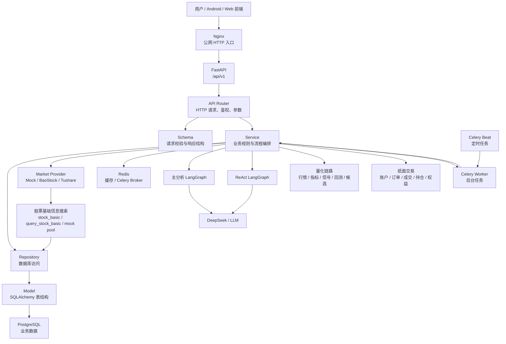

# 项目介绍

本文是后端正式项目文档的总入口，面向项目展示、后端维护和 Android / Web 前端开发前的整体理解。

## 一、项目定位

本项目是一个 AI 股票分析后端系统，核心目标是把商业后端能力、股票行情与量化分析、DeepSeek + LangGraph AI 分析链路结合起来。

当前后端已经基本完成，能力覆盖：

```text
用户认证
自选股
用户偏好
通知与设备
个股 AI 分析
普通追问
ReAct 工具增强追问
行情同步
真实 Provider 股票搜索
K 线落库
数据质量检查
技术指标
策略信号
单股回测
组合回测
候选股票评分
AI 候选解释
AI 用量和额度
后台任务
用户记忆和向量检索
每日简报
量化提醒
纸面交易
生产部署
GitHub Actions 自动部署
```

项目性质是“商业目标兼顾学习，学习为主”。因此它既要有商业后端的分层、鉴权、数据库、测试、部署、安全边界，也要通过中文注释和文档帮助开发者理解为什么这样设计。

## 二、重要边界

| 边界 | 说明 |
| ---- | ---- |
| 投资建议边界 | AI 分析、技术指标、策略信号、回测、候选评分都不构成投资建议 |
| 收益承诺边界 | 系统不承诺未来收益，历史回测不代表未来表现 |
| 真实交易边界 | 纸面交易只做模拟，不连接券商，不真实下单 |
| 数据边界 | 股票基础信息和 K 线可能来自 mock、baostock、tushare 等 Provider；搜索结果会优先缓存到 `market_symbols`，K 线质量由数据质量模块判断 |
| 密钥边界 | `.env.production`、DeepSeek Key、JWT 密钥、数据库密码、SSH 私钥不能提交或泄露 |

## 三、技术栈

| 类型 | 技术 |
| ---- | ---- |
| Web 框架 | FastAPI |
| 数据校验 | Pydantic |
| ORM | SQLAlchemy AsyncSession |
| 数据库迁移 | Alembic |
| 数据库 | PostgreSQL |
| 缓存 / 队列 | Redis |
| AI 编排 | LangGraph |
| LLM | DeepSeek，OpenAI-compatible client |
| 后台任务 | Celery Worker / Celery Beat |
| 包管理 | uv |
| 部署 | Docker Compose |
| 反向代理 | Nginx |
| CI/CD | GitHub Actions |

## 四、后端目录结构

```text
backend/
├── app/
│   ├── api/routers/       # HTTP API 路由
│   ├── schemas/           # Pydantic 请求和响应结构
│   ├── services/          # 业务逻辑和流程编排
│   ├── repositories/      # 数据库访问层
│   ├── models/            # SQLAlchemy 数据模型
│   ├── core/              # 配置、数据库、Redis、安全、异常、日志、LLM、Celery
│   ├── graphs/            # LangGraph 状态、节点、路由、图编排
│   ├── tasks/             # Celery 后台任务
│   └── utils/             # 通用响应等工具
├── alembic/               # 数据库迁移
├── tests/                 # pytest 测试
├── scripts/               # 回归脚本
├── nginx/                 # Nginx 配置
├── docs/                  # 正式项目文档
├── Dockerfile
├── docker-compose.yml
└── docker-compose.prod.yml
```

## 五、整体架构



## 六、核心业务模块

| 模块 | 主要能力 | 前端常见页面 |
| ---- | -------- | ------------ |
| 认证 | 注册、登录、刷新 token、退出登录 | 登录页、注册页 |
| 用户 | 当前用户资料、更新资料 | 我的页面 |
| 自选股 | 添加、查看、更新、删除关注股票 | 自选股页 |
| 偏好 | 风险偏好、通知偏好、时区等 | 设置页 |
| 行情 | 股票搜索、Provider 基础信息缓存、报价、K 线、overview | 股票搜索页、行情详情页 |
| 技术指标 | MA、RSI、MACD、波动率、动量、成交量 | 技术指标页 |
| 策略信号 | buy、sell、hold、observe 规则信号 | 股票详情页、纸面交易页 |
| AI 分析 | 个股分析、普通追问、ReAct 追问 | AI 分析页、聊天页 |
| 回测 | 单股回测、组合回测 | 回测页 |
| 候选评分 | 候选股票评分、AI 候选解释 | 研究/候选页 |
| 日报 | 生成和查询每日简报 | 每日简报页 |
| 量化提醒 | 规则、事件、扫描、已读 | 提醒页 |
| 纸面交易 | 虚拟账户、配置、tick、订单、成交、持仓、权益 | 模拟盘页 |
| 后台任务 | 提交任务、查询任务、取消任务 | 管理/任务页 |

## 七、前端开发建议阅读顺序

Android 或 Web 前端对接时，建议按下面顺序阅读：

```text
1. 前端对接指南.md
2. 业务术语与数据字典.md
3. api全面介绍.md
4. 图结构介绍.md
5. 量化策略介绍.md
6. 回测业务介绍.md
7. 部署与环境说明.md
```

如果只想快速跑通 App 第一版，优先关注：

```text
认证接口
当前用户接口
自选股接口
行情 overview 接口
股票搜索接口
个股 AI 分析接口
分析记录接口
```

## 八、当前文档关系

| 路径 | 定位 |
| ---- | ---- |
| `backend/docs/` | 后端正式项目文档，面向前端对接、项目展示和维护 |
| `docs/backend/开发文档.md` | 历史开发规则、阶段计划、AI 协作说明 |
| `docs/backend/项目流程计划/` | 阶段目标和具体流程记录 |
| `backend/README.md` | 仓库说明入口 |
